# FLOP GPU Miner Setup Guide (Devnet)

**English** | [Türkçe](Turkce-Kurulum.md)

> [!WARNING]
> **Update, 12 November 2026:** the guide now uses worker v0.1.336, FLOP's newest release. It
> takes paid sessions only with an encrypted evidence store: without one, every session gets
> `503 session evidence publication unavailable`. Step 9 and the guide's `docker-compose.yml` now
> set this up. On FLOP's public RPC, v0.1.336 answers the gateway's health checks too slowly and
> many are cancelled; [step 20](#20-speed-patch-for-worker-v01336) fixes this, and
> [step 19](#19-install-the-tunnel-watch) keeps the tunnel address up to date. If you set up before
> this date, follow [Updating to a New Release](#updating-to-a-new-release).
>
> **Update, 9 November 2026:** when the worker cannot confirm a transaction it sent, for example
> because the RPC connection dropped, it locks itself (`miner signer is fenced`) and takes no new
> sessions. The lock never opens by itself. The guard in [step 18](#18-install-the-fence-guard)
> opens it once the chain shows it is safe. If you set up before this date, do step 18.
>
> **Update, 8 November 2026:** the worker was missing the `SESSION_COMMIT_IDS` setting, which
> FLOP's miner docs leave out. Without it, sessions stop with
> `V2 leaf cannot bind a TOPLOC activation commitment (fail closed)` and the miner is never paid.
> The guide's files now have this setting. If you set up before this date, apply
> [this fix](#v2-leaf-cannot-bind-a-toploc-activation-commitment-fail-closed).
>
> **Update, 7 November 2026:** the devnet moved to runtime version 1014014 at 05:23 UTC. CLI
> v0.1.220, which this guide used before, does not work with it: `model fetch` and `miner status`
> stop with `Unsupported runtime spec version 1014014`. The guide now uses CLI v0.1.290. If you
> started the setup before this date, apply [this fix](#unsupported-runtime-spec-version-1014014).

This guide is for anyone who wants to rent a virtual machine (VM) with an NVIDIA GPU on Vast.ai
and run a GPU miner on the FLOP Devnet.

FLOP is a network where AI agents pay to get answers from AI models. A miner's machine runs a
model on its GPU, answers the jobs the network sends, and produces data that proves the work was
really done with the registered model.

At the end of the setup, two programs run on the server:

- `backend`: runs the model on the GPU (vLLM and TOPLOC).
- `worker`: takes jobs from the network, signs the answers with the miner account and reports
  them to the chain.

The FLOP Devnet opened to everyone on 3 November 2026. You do not need an application or an
invitation to become a miner. The network covers the stake needed to register, so you do not
have to buy or deposit any FLOP.

> [!IMPORTANT]
> The devnet is a test network. It gives no rewards and no airdrop points, and it can be reset.
> The goal here is to have your machine ready on day one when the testnet opens. There is no
> FLOP token yet: anything that says "buy", "claim" or "mint" is a scam. Never share your seed
> phrase. All official links are on https://flop.finance/official/.

> [!NOTE]
> Steps 1 to 17 were tested end to end on 3 November 2026 on two separate Ubuntu 22.04 VMs on
> Vast.ai, one with 1x RTX 5090 and one with 1x RTX 5060 Ti. Both passed calibration. The outputs
> in the images come from the RTX 5090 setup. Step 18 was added on 9 November 2026 and tested on a
> running RTX 5060 Ti miner. Worker v0.1.336 with the evidence store and steps 19 and 20 were
> tested on 12 November 2026 on a running RTX 3090 miner.

---

## Overview

| Item | Value |
| --- | --- |
| Network | FLOP Devnet |
| Role | GPU Miner (SOFT tier, no extra hardware attestation needed) |
| Model | Qwen/Qwen2.5-0.5B-Instruct (BF16) |
| Stake | Covered by the network: 1,000,000 devnet FLOP at first registration |
| Reward | None (devnet) |
| Official miner docs | https://docs.flop.network/docs/run-miner |
| Explorer | https://explorer.devnet.flop.network/mining |
| RPC | `wss://rpc.devnet.flop.network` |

---

## System Requirements

| Part | Requirement |
| --- | --- |
| GPU | NVIDIA, at least 16 GB VRAM |
| Driver | NVIDIA driver with CUDA 13.0 support (580 or newer) |
| Machine | A full virtual machine (VM) that can run Docker, or your own server |
| Disk | At least 60 GB free. The finished setup used 31 GB |
| Operating system | Ubuntu 22.04 or 24.04 |
| Internet | The model program alone is a 23 GB download |

### Tested Cards

| Card | VRAM | Vast.ai price per hour | Calibration |
| --- | --- | --- | --- |
| RTX 5060 Ti | 16 GB | About $0.20 | Accepted, 130 GFLOP/s |
| RTX 5090 | 32 GB | About $0.70 | Accepted, 200 GFLOP/s |

The most affordable option is the 16 GB RTX 5060 Ti. The prices include disk; internet traffic
is charged separately. These are the prices on 3 November 2026 and they vary by machine.

You can also use other cards and other providers that meet the requirements above. If you use
Vast.ai, pick a template with the **VM** tag. Docker does not run on the normal templates.

---

## 1. Create an SSH Key

You will connect to the server from your own computer over SSH. For that you need an SSH key.

### Windows:

- First, follow my WSL installation guide: https://x.com/UfukDegen/status/1944066889346429338
- After completing the WSL setup, run the commands below in the WSL terminal.

### macOS:

- Run the commands below in the Terminal app.

```bash
ssh-keygen -t ed25519 -C "vast-flop"
```

- Press Enter to accept the default answers.
- If you already have a key, answer `n` to `Overwrite (y/n)?` and use your existing key.

Print your public key:

```bash
cat ~/.ssh/id_ed25519.pub
```

Copy the whole line that starts with `ssh-ed25519`. This line is not secret; it is what you give
to Vast.ai. Never share the `id_ed25519` file in the same folder (the one without `.pub`).

---

## 2. Vast.ai Account and SSH Key

1. Open the [Vast.ai sign up and login page](https://cloud.vast.ai/?ref_id=222215) and sign in.
2. Go to **Billing** in the left menu and add credit with **Add Credit**.

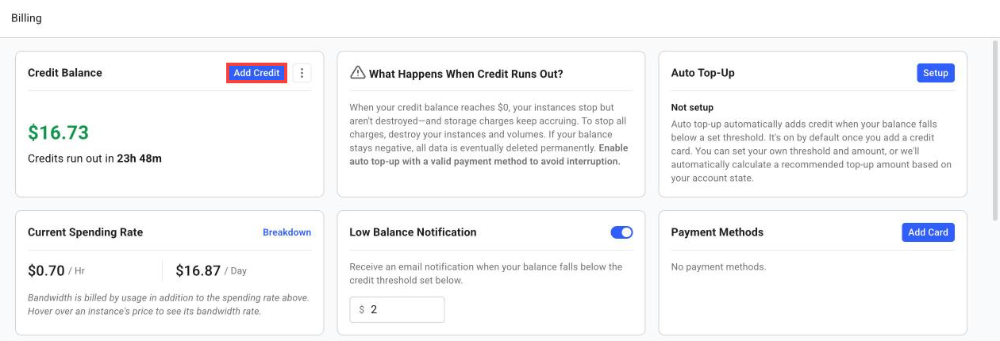

3. Go to **Keys** in the left menu.
4. On the **SSH Keys** tab, click **+ New**.
5. Paste the `ssh-ed25519 ...` line you copied and click **Save**.

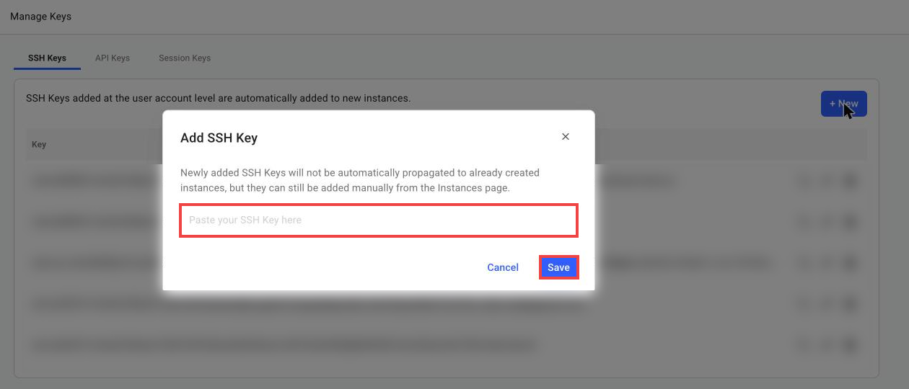

Keys on your account are added automatically to every server you rent from now on. A key added
after a server is rented is not added to that server.

---

## 3. Rent a VM

1. Go to **Search** in the left menu.
2. In the template box on the left, click **Change Template**.
3. Under **Tags** at the top right, choose the **VM** tag.
4. Click the ▶ button under the **Ubuntu 22.04 VM** template.

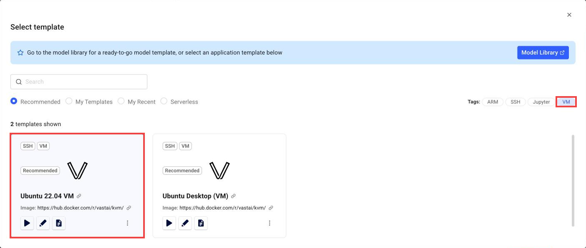

5. In the filters at the top, choose **On-Demand**, **RTX 5060 Ti** or **RTX 5090** as the GPU,
   and your region.
6. Check that the machine's `Max CUDA` value is `13.0` or higher.
7. Hover over the price to see the total hourly cost.

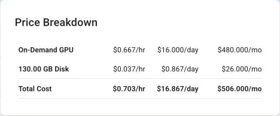

8. Click **RENT** on a suitable machine.

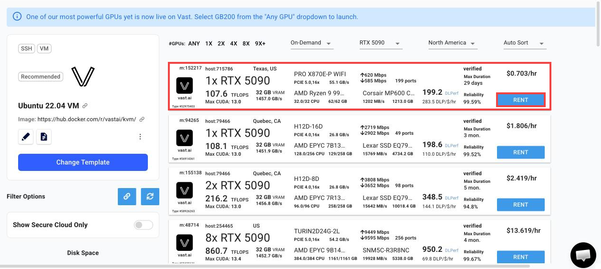

When choosing a machine, look at:

- The GPU model and count
- The `Max CUDA` value (13.0 or higher)
- The reliability rate (Reliability)
- The total hourly cost and the internet cost
- The longest rental time (Max Duration)

> [!IMPORTANT]
> **Stop** pauses the GPU cost, but the disk cost continues. **Destroy** deletes the server and
> all its files for good. If your credit runs out, the server stops.

---

## 4. Connect to the Server

1. Go to **Instances** in the left menu.
2. Wait for the server to start. Vast says a VM can take up to 30 minutes to start. In the test,
   the RTX 5090 server started within 2 minutes.
   If the server does not start for a long time, or its status becomes `exited`, delete it with
   **Destroy** and rent another machine. The first RTX 5060 Ti I tried never started; the second
   one started without problems.
3. When the server is up, click the **>_Connect** button.

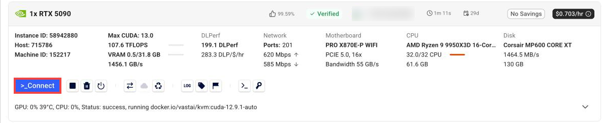

4. Copy the command on the **Direct SSH Connect** line.

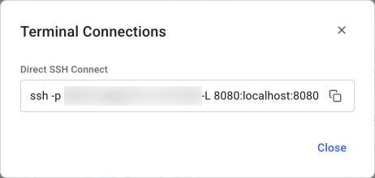

5. Paste the command into your own computer's terminal. The `-L 8080:localhost:8080` part at the
   end is not needed; you can delete it.

```bash
ssh -p PORT root@SERVER_IP
```

- `PORT` and `SERVER_IP` are in the command Vast gives you.
- On the first connection, answer `yes` to `Are you sure you want to continue connecting (yes/no)?`.

From here on, every command runs on the server.

---

## 5. Check the GPU and Docker

```bash
nvidia-smi --query-gpu=name,driver_version,memory.total --format=csv
docker --version && docker compose version
```

You should see your card's name, a driver version of `580` or newer, and the Docker versions:

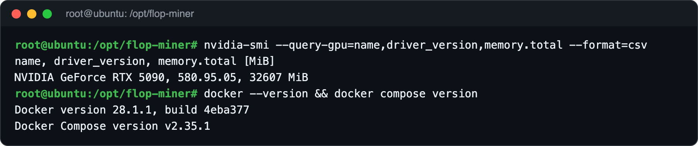

---

## 6. Install the NVIDIA Container Toolkit

Docker comes ready on a Vast VM, but the tool that connects the graphics card to Docker is
missing. Without it the programs cannot see the GPU and you get this error:
`could not select device driver "" with capabilities: [[gpu]]`

```bash
apt-get update && apt-get install -y nvidia-container-toolkit
nvidia-ctk runtime configure --runtime=docker
systemctl restart docker
```

Test that the GPU is visible inside Docker:

```bash
docker run --rm --gpus all nvidia/cuda:13.0.1-base-ubuntu22.04 nvidia-smi --query-gpu=name,driver_version,memory.total --format=csv
```

If the last line shows your card's name, this step is done:

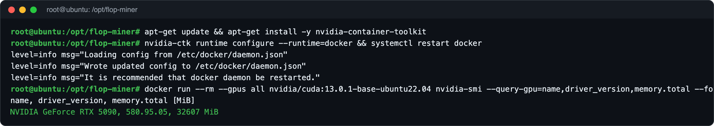

---

## 7. Download the Guide Files and Prepare the Settings

```bash
cd ~
git clone https://github.com/UfukNode/flop-miner-setup.git
mkdir -p /opt/flop-miner/models
cp flop-miner-setup/docker-compose.yml flop-miner-setup/miner.env.example flop-miner-setup/sponsor.mjs /opt/flop-miner/
cd /opt/flop-miner
install -m 600 miner.env.example miner.env
```

Create the secret values in the settings file and give your miner a name:

```bash
sed -i "s/^INFERENCE_API_KEY=.*/INFERENCE_API_KEY=$(openssl rand -hex 32)/" miner.env
sed -i "s/^SESSION_AUTH_TOKEN=.*/SESSION_AUTH_TOKEN=$(openssl rand -hex 32)/" miner.env
sed -i "s/^WORKER_NAME=.*/WORKER_NAME=your-miner-name/" miner.env
```

- Replace `your-miner-name` with a name for your miner. Use letters, numbers and dashes.

Add the two shortcuts the next steps use:

```bash
cat >> ~/.bashrc <<'EOF'
export FLOP_CLI="$(grep '^FLOP_CLI=' /opt/flop-miner/miner.env 2>/dev/null | cut -d= -f2-)"
compose() { docker compose --env-file /opt/flop-miner/miner.env -f /opt/flop-miner/docker-compose.yml "$@"; }
flop() { docker run --rm --network host -e FLOP_KEY_PASSWORD -v /opt/flop-miner:/work "$FLOP_CLI" "$@"; }
EOF
source ~/.bashrc
```

- `compose`: manages the miner programs (backend and worker).
- `flop`: FLOP's official command line tool. The `/opt/flop-miner` folder appears inside it as
  `/work`.

---

## 8. Download the FLOP Programs

```bash
docker pull "$FLOP_CLI"
compose pull
```

The model program (`miner-vllm-toploc`) is 23 GB. In the test, the three programs took 3.5
minutes to download.

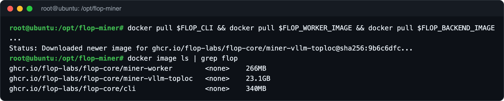

---

## 9. Create the Miner Wallet

The miner has an account of its own. The signatures on its work and its stake belong to this
account.

```bash
cd /opt/flop-miner
umask 077
flop keys generate --type sr25519 --show-secret --json > /root/miner-key.json
jq -r .mnemonic /root/miner-key.json > /opt/flop-miner/signer
chmod 600 /opt/flop-miner/signer
jq -r .address /root/miner-key.json
```

The last command prints your miner address (it starts with `5`). Save this address somewhere.

Print the 24 words once and write them down on paper, then delete the temporary file:

```bash
cat /opt/flop-miner/signer
rm /root/miner-key.json
```

Create the session key:

```bash
install -d -m 700 /opt/flop-miner/session-keys
sh -c 'umask 077; openssl rand -hex 32 > /opt/flop-miner/session-keys/enclave.seed'
```

Create the evidence key. From worker v0.1.336 on, the worker keeps the evidence of every paid
session in an encrypted store and takes paid sessions only when it has one. This file is the key
of that store:

```bash
install -d -m 700 /opt/flop-miner/audit-key
sh -c 'umask 077; openssl rand -hex 32 > /opt/flop-miner/audit-key/evidence.key'
```

> [!CAUTION]
> The `signer` file is your miner account itself. Never send it to anyone, never take a
> screenshot of it and never upload it to GitHub. If the worker cannot find this file, it tries
> to run with FLOP's public test account `//Alice`. In step 14, make sure the `Signer:` line in
> the log shows your own address.

---

## 10. Register with the Stake Sponsor

On the devnet, FLOP covers the miner stake itself. This command signs a request with your miner
account and sends it to FLOP's sponsor service. The sponsor registers your account as a miner and
deposits the stake.

```bash
docker run --rm -v /opt/flop-miner:/work --entrypoint node "$FLOP_CLI" /work/sponsor.mjs
```

If you see `HTTP 200` and `"success":true`, the registration is done. The network deposits
1,000,000 test FLOP as stake and 250 test FLOP for transaction fees into your account:

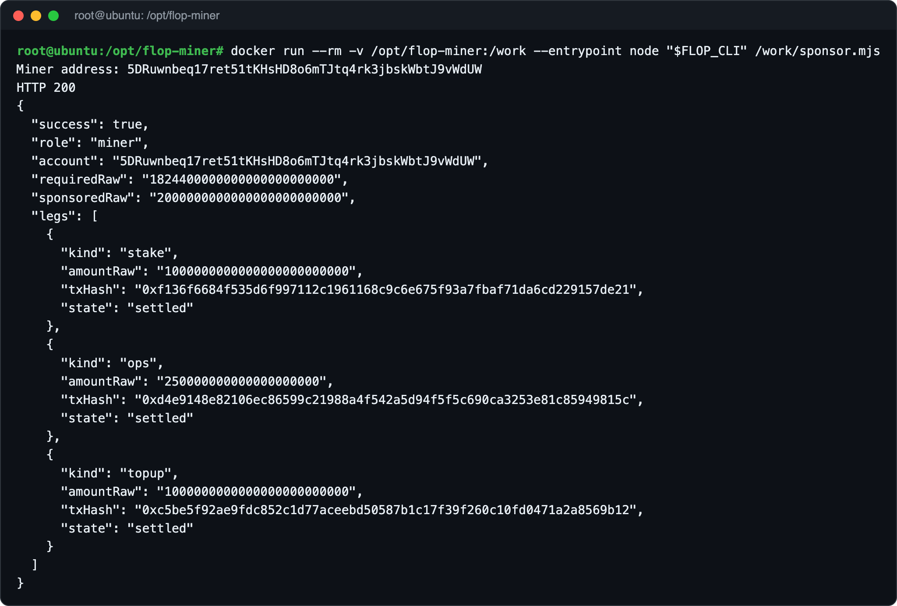

- Do not run `flop miner register` yourself. The sponsor already registers you.
- `429` with the message `automatic miner sponsorship is full` means the sponsor is full right
  now. At most 40 sponsored miners can wait for calibration at the same time, and the sponsor takes
  at most 100 new miners a day. A slot opens when one of them calibrates. Run the same command
  again after a while. If you get `503`, also try again after a while.
- A registered miner holds one of these places until it calibrates. Continue with the next steps
  right after this one.
- Faster cards need more stake. If you run the same command once more, the sponsor tops the stake
  up to at most 2,000,000 test FLOP. In the test, 1,000,000 was enough for the RTX 5060 Ti; the
  RTX 5090 needed the second request.

---

## 11. Download and Verify the Model

FLOP's tool downloads the model and compares the files with the record on the chain. If they do
not match the record exactly, it does not write the files.

```bash
flop --network devnet --rpc wss://rpc.devnet.flop.network model fetch 0x1a52c1abe781db051e70ae357f72bb70161ca0c092df0b618f22a9292ba63306 --precision BF16 --output-dir /work/models/qwen2.5-0.5b-instruct --json
```

You should see `"ok": true` and a `verified_root` value equal to the model hash (without the `0x`).
The picture shows the older CLI, where this value was called `computed_root`:

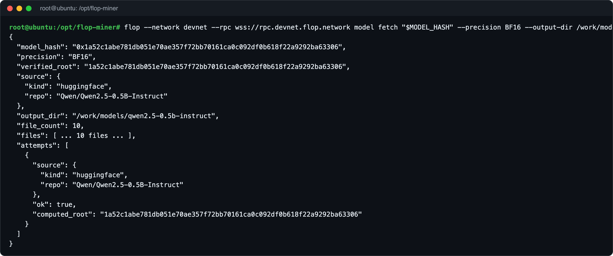

If the first attempt fails with `MODEL_VERIFICATION_FAILED` and `fetch failed`, run the same
command again. In the test, the first attempt gave this error and the second one worked.

If the error says `Unsupported runtime spec version`, your CLI is older than the chain: apply
[this fix](#unsupported-runtime-spec-version-1014014).

---

## 12. Start the Backend

```bash
cd /opt/flop-miner
compose up -d backend
compose logs -f backend
```

When the log shows the `MODEL_DIR reproduces MODEL_HASH` and `Uvicorn running` lines, the model
is loaded on the GPU. Leave the logs with `CTRL + C`; the program keeps running.

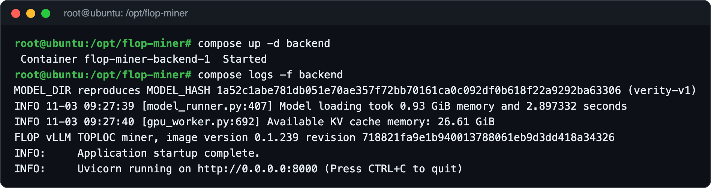

Run the backend health check:

```bash
compose exec -T backend python3 -c 'import os, json, urllib.request as u; r=json.loads(u.urlopen(u.Request("http://127.0.0.1:8000/health", headers={"Authorization": "Bearer " + os.environ["INFERENCE_API_KEY"]})).read()); print(json.dumps({k: r.get(k) for k in ("model_identity","model_hash","precision","decode_policy_hash","image")}, indent=2))'
```

`model_identity` should be `measured` and the model hash should match the one in step 11:

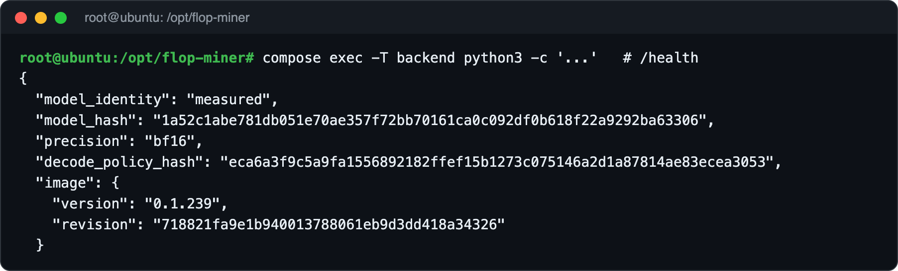

---

## 13. Set Up the HTTPS Tunnel

The network needs an HTTPS address to reach your miner. Ports 80 and 443 cannot be opened
directly on Vast, so we use Cloudflare's free tunnel. You do not need an account.

```bash
cd ~
curl -fsSL -o cloudflared.deb https://github.com/cloudflare/cloudflared/releases/latest/download/cloudflared-linux-amd64.deb
dpkg -i cloudflared.deb
```

Install the tunnel as a service that keeps running even when the server restarts:

```bash
sudo tee /etc/systemd/system/flop-tunnel.service > /dev/null <<'EOF'
[Unit]
Description=FLOP miner HTTPS tunnel
After=network-online.target
Wants=network-online.target

[Service]
ExecStart=/usr/bin/cloudflared tunnel --no-autoupdate --url http://127.0.0.1:8645
Restart=always
RestartSec=5

[Install]
WantedBy=multi-user.target
EOF
systemctl daemon-reload
systemctl enable --now flop-tunnel
```

Wait a few seconds and see your tunnel address:

```bash
journalctl -u flop-tunnel --no-pager | grep -o 'https://[a-z0-9-]*\.trycloudflare\.com' | tail -1
```

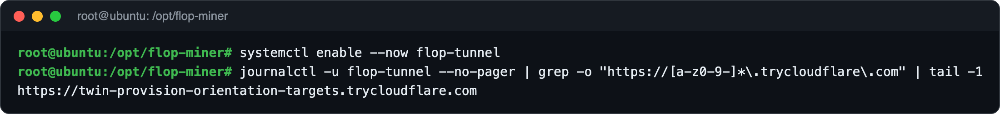

Write the address into the settings file:

```bash
H=$(journalctl -u flop-tunnel --no-pager | grep -o '[a-z0-9-]*\.trycloudflare\.com' | tail -1)
sed -i "s/^SESSION_PUBLIC_HOST=.*/SESSION_PUBLIC_HOST=$H/" /opt/flop-miner/miner.env
grep '^SESSION_PUBLIC_HOST=' /opt/flop-miner/miner.env
```

> [!NOTE]
> This free tunnel gets a new address whenever the tunnel restarts. If it changes, run the last
> three commands again and restart the worker with `compose up -d worker`, or install the tunnel
> watch from [step 19](#19-install-the-tunnel-watch), which does this for you.

---

## 14. Start the Worker

```bash
cd /opt/flop-miner
compose up -d worker
compose logs -f worker
```

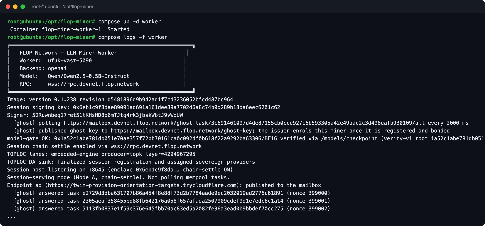

Check these lines in the log:

| Line | Meaning |
| --- | --- |
| `Image: version 0.1.336` | The worker version |
| `Signer: 5...` | Must be the miner address you created in step 9 |
| `[ghost] published ghost key` | The key the network sends test jobs to is published |
| `model-gate OK` | The model matches the record on the chain |
| `Session host listening on :8645` | The worker is listening for requests |
| `Endpoint ad (...): published to the mailbox` | Your tunnel address is announced to the network |
| `[ghost] answered task ...` | The test jobs the network sends are being answered |

---

## 15. Check Everything

Send a request to your tunnel address from your own computer:

```bash
curl -s -o /dev/null -w "%{http_code}\n" https://YOUR-TUNNEL-ADDRESS/session/info
```

A `401` answer is normal. It means the address works and refuses requests without a key.

On the server, check that the worker can take paid sessions:

```bash
T=$(grep '^SESSION_AUTH_TOKEN=' /opt/flop-miner/miner.env | cut -d= -f2)
curl -s -H "Authorization: Bearer $T" http://127.0.0.1:8645/session/info | jq '{is_ready, audit_handoff_enabled}'
```

`audit_handoff_enabled` must be `true`; if it is `false`, the evidence store is missing (see
[this entry](#session-evidence-publication-unavailable)). `is_ready` becomes `true` once
calibration is accepted in step 17.

Check the miner's status on the chain:

```bash
flop --network devnet --rpc wss://rpc.devnet.flop.network miner status YOUR_MINER_ADDRESS
```

`registered` should be `true` and `stake` should show the stake the sponsor deposited:

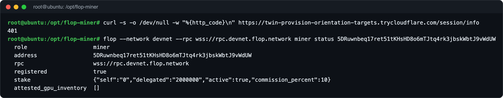

Open your account on the explorer:

```text
https://explorer.devnet.flop.network/account/YOUR_MINER_ADDRESS
```

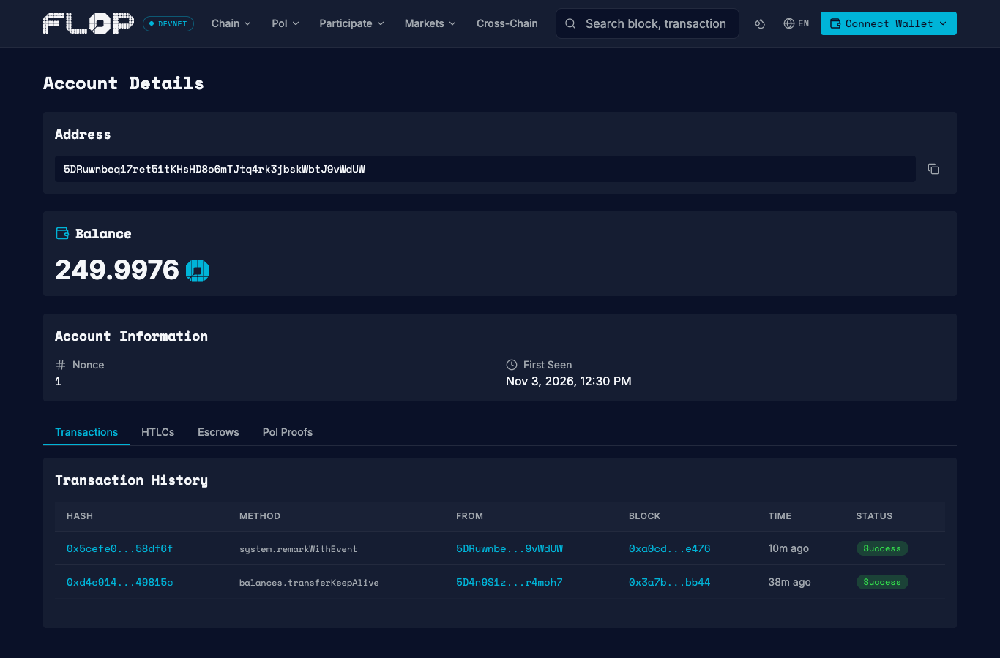

---

## 16. Declare the GPU on Chain (Optional)

To have your card show up in the explorer's miner list, you can write the GPU information to the
chain. First, put your miner key into an encrypted file. Choose a password and do not forget it:

```bash
cd /opt/flop-miner
read -r -s -p 'Keystore password: ' FLOP_KEY_PASSWORD && export FLOP_KEY_PASSWORD && echo
MINER_SECRET="$(cat /opt/flop-miner/signer)" docker run --rm --network host -e MINER_SECRET -e FLOP_KEY_PASSWORD -v /opt/flop-miner:/work "$FLOP_CLI" keys import --type sr25519 --secret-env MINER_SECRET --out /work/miner.json --password-env FLOP_KEY_PASSWORD
```

Write the GPU information:

```bash
nvidia-smi --query-gpu=name,memory.total --format=csv,noheader,nounits | docker run -i --rm --network host -e FLOP_KEY_PASSWORD -v /opt/flop-miner:/work "$FLOP_CLI" --network devnet --rpc wss://rpc.devnet.flop.network --keystore /work/miner.json --password-env FLOP_KEY_PASSWORD miner declare-gpu --nvidia-smi -
```

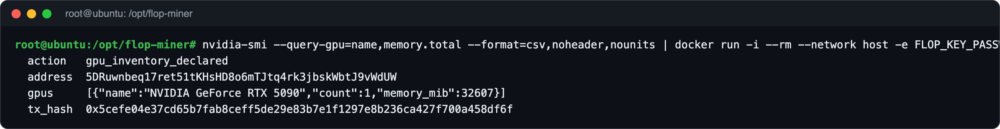

The transaction fee comes out of the 250 FLOP the sponsor gave. In the test, the fee was 0.0024
FLOP.

---

## 17. Follow the Calibration

To measure how much work your miner can really do, the network sends it test jobs (the
`[ghost] answered task` lines in the log). When enough jobs are verified, the worker writes this
line:

```text
[calibration] ... cap accepted: ... GFLOP/s from ... verified jobs
```

Under the current rule on the chain, this needs at least 64 verified jobs within a window of at
least 600 blocks (about 11 minutes). The measurement is renewed once a week.

```bash
compose logs worker | grep -E "answered task|calibration" | tail
flop --network devnet --rpc wss://rpc.devnet.flop.network miner status YOUR_MINER_ADDRESS --json | jq .calibration
```

In the test, calibration was accepted about 12 minutes after the worker started: 64 verified
jobs within 621 blocks and 200 GFLOP/s on the RTX 5090, and 64 verified jobs within 618 blocks
and 130 GFLOP/s on the RTX 5060 Ti. If the `calibration` field shows these values instead of
`null`, your miner is ready:

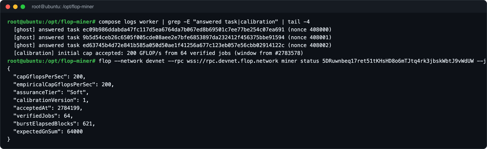

On the explorer, open the **Mining** page from the **PoI** menu and the **Calibration** tab, and
you will see your miner as `Active`: https://explorer.devnet.flop.network/mining

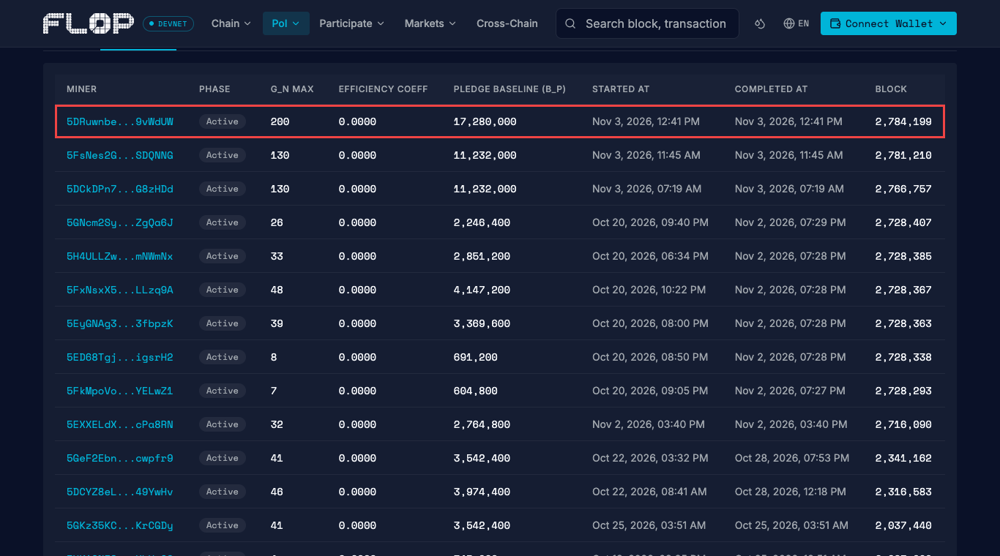

> [!IMPORTANT]
> Keep the worker running. If a test job from the network is not answered within 600 blocks, it
> expires and the miner's stake is cut (slashed).

If the stake runs short during calibration, run the sponsor command from step 10 again.

After calibration, the network starts sending your miner paid sessions. A finished session shows
up in the worker log as `[session] settle cooperative`, and the payment goes to your miner account
in test FLOP:

```bash
compose logs worker | grep -E "\[session\] (open|settle|error)" | tail
```

> [!NOTE]
> Fees: worker v0.1.336 records evidence for each turn and for the session's transcript, about
> 1.31 test FLOP each ([#163](https://github.com/flop-labs/network/issues/163)). A one-turn session
> cost 2.63 test FLOP in fees in our test. The miner gets 0.003 test FLOP per G_n, less 1 %, so a
> one-turn session needs about 885 G_n to pay for its fees: about 440 tokens with this guide's
> 0.5B model (2 G_n per token). Most sessions are smaller than that. FLOP has no top-up for the
> sponsor's fee grant yet ([#175](https://github.com/flop-labs/network/issues/175)); the faucet at
> https://faucet.flop.network gives 25 test FLOP per address per day.

---

## 18. Install the Fence Guard

If the worker cannot confirm the result of a transaction it sent, for example because the RPC
connection dropped while it was waiting, it locks itself to stay safe. The log then shows
`miner signer is fenced`, new sessions get `503` and the miner is not paid. The lock never opens
by itself, and a restart does not open it.

This guard checks the worker every 2 minutes. When the worker is locked, it first asks the worker
to prove on the chain what happened to the stuck transaction: worker v0.1.336 and later keep the
signed transaction in the lock file, check it themselves and unlock without a restart. For older
workers, the guard asks the chain whether the stuck transaction can still go through. Only when it
cannot does the guard keep a copy of the lock file, remove the lock and restart the worker.

```bash
U=https://raw.githubusercontent.com/UfukNode/flop-miner-setup/main/fence-guard
install -d -m 700 /opt/flop-miner/fence-guard
cd /opt/flop-miner/fence-guard
curl -fsSL --remote-name-all "$U"/{fence-guard.sh,status.mjs,recover.mjs,reconcile.mjs,worker-reconcile.mjs}
chmod +x fence-guard.sh
curl -fsSL -o /etc/systemd/system/flop-fence-guard.service "$U/flop-fence-guard.service"
curl -fsSL -o /etc/systemd/system/flop-fence-guard.timer "$U/flop-fence-guard.timer"
systemctl daemon-reload
systemctl enable --now flop-fence-guard.timer
```

Check that it runs and that the worker is not locked:

```bash
systemctl list-timers flop-fence-guard.timer --no-pager
compose exec -T worker node --input-type=module < status.mjs | jq .
```

The timer should show its next run, and `"fenced": false` means the worker is not locked:

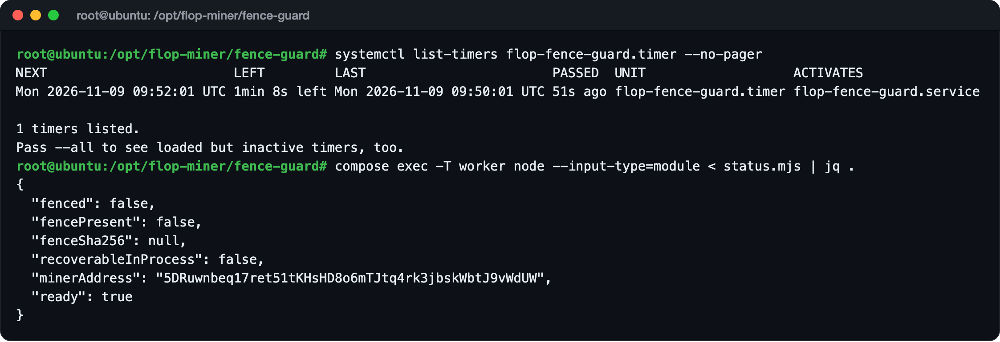

- With worker v0.1.336, a transaction lives 64 blocks on the chain, so the worker can prove its
  outcome soon after it expires. With older workers, the guard opens the lock only after the stuck
  transaction's lifetime (512 blocks, about 9 minutes) has passed, nothing from the miner account
  is pending and no session is open, and it waits at most 90 minutes for open sessions.
- The guard writes what it does to `/opt/flop-miner/fence-guard/guard.log`.
- If you installed the guard before 12 November, run the commands above again to get
  `worker-reconcile.mjs`.

---

## 19. Install the Tunnel Watch

The free tunnel from step 13 gets a new address every time it restarts, for example when the
server reboots. The worker then keeps announcing the old address and gets no sessions until the
new one is written into `miner.env`.

This timer checks every minute. When the tunnel has a new address, it writes it into `miner.env`
and restarts the worker. When the worker answers on the server but not through the tunnel 3
checks in a row, it restarts the tunnel and does the same.

```bash
U=https://raw.githubusercontent.com/UfukNode/flop-miner-setup/main/tunnel-watch
install -d -m 755 /opt/flop-miner/tunnel-watch
curl -fsSL -o /opt/flop-miner/tunnel-watch/tunnel-watch.sh "$U/tunnel-watch.sh"
chmod +x /opt/flop-miner/tunnel-watch/tunnel-watch.sh
curl -fsSL -o /etc/systemd/system/flop-tunnel-watch.service "$U/flop-tunnel-watch.service"
curl -fsSL -o /etc/systemd/system/flop-tunnel-watch.timer "$U/flop-tunnel-watch.timer"
systemctl daemon-reload
systemctl enable --now flop-tunnel-watch.timer
```

Check that it runs:

```bash
systemctl list-timers flop-tunnel-watch.timer --no-pager
journalctl -u flop-tunnel-watch -o cat --no-pager | grep -E "tunnel address|outside check|restarting" | tail -3
```

The timer should show its next run. After an address change, the log shows
`tunnel address OLD -> NEW, worker recreated`:

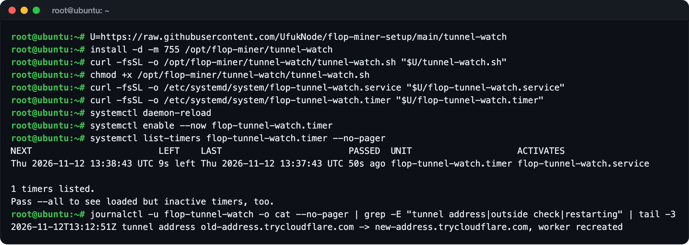

- It restarts the worker only under the fence guard's lock, so the two never run at the same time.
- If the worker itself is down, it leaves the tunnel alone; Docker restarts the worker.

---

## 20. Speed Patch for Worker v0.1.336

Worker v0.1.336 reads the miner's calibration and checks its evidence store on the chain every
time FLOP's gateway asks whether the miner is healthy (about once a minute) and every time a
session opens. On FLOP's public RPC one health check took 2.0-2.5 seconds in our test, and the
gateway cancelled 20 of our answers in 37 minutes, most of them health checks and one a session
open.

This script makes the worker answer from the calibration status it already refreshes in the
background, and reuse a ready evidence-store check for 20 seconds and a session's channel for 10
seconds. A check that is not ready is never reused. It also writes refused session requests, except
plain `401` answers, to the log as `[http] ... -> CODE`.

```bash
cd /opt/flop-miner
curl -fsSL -o patch-worker.sh https://raw.githubusercontent.com/UfukNode/flop-miner-setup/main/worker-patch/patch-worker.sh
bash patch-worker.sh
```

Check that the worker runs the patched file:

```bash
compose exec -T worker sha256sum /repo/sdk/miner-worker/miner-worker.mjs
```

The value should match the `patched file:` line:

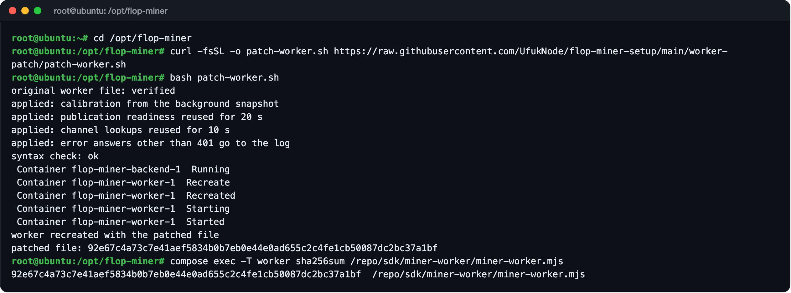

- With the patch, most health checks took 3 milliseconds. In 45 minutes the gateway cancelled no
  health check, only 3 session closes, which do no harm. A session's first answer came 0.9 seconds
  after it opened instead of 10.6.
- Lines like `[http] POST /session/close -> 409 channel close is in progress` are normal: closing a
  session now also uploads its transcript, which took up to 3.5 minutes in our test, and the
  gateway asks again in the meantime.
- The script works only with worker v0.1.336. It checks FLOP's original file before changing
  anything and keeps a copy of it in `/opt/flop-miner/patches`.
- Before moving to a newer worker, undo it: `bash /opt/flop-miner/patch-worker.sh --undo`

---

## Useful Commands

### Follow the worker log

```bash
compose logs -f worker
```

### Follow the backend log

```bash
compose logs -f backend
```

### Status of the programs

```bash
compose ps
```

### Restart the worker

```bash
compose restart worker
```

### Stop and start the programs

```bash
compose stop
compose up -d
```

### Tunnel status

```bash
systemctl status flop-tunnel
```

### Watch the GPU

```bash
nvidia-smi
```

Leave the logs with `CTRL + C`; the programs keep running.

---

## Updating to a New Release

1. If you applied a speed patch (step 19 before 12 November, or step 20), undo it first:
   `bash /opt/flop-miner/patch-worker.sh --undo`. Each patch fits only one worker version. After
   updating to v0.1.336, apply [step 20](#20-speed-patch-for-worker-v01336).
2. Get the new `image` values for `cli`, `miner-worker` and `miner-vllm-toploc` from
   https://flop.network/releases.json. The list can fall behind the chain: on 7 November 2026 it
   still named CLI v0.1.220, which no longer works. When in doubt, use the lines in this guide's
   `miner.env.example`.
3. Change the `FLOP_CLI`, `FLOP_WORKER_IMAGE` and `FLOP_BACKEND_IMAGE` lines in
   `/opt/flop-miner/miner.env`.
4. Worker v0.1.336 and later need the evidence store. If your `docker-compose.yml` has no
   `SESSION_AUDIT_EVIDENCE_DIR` line, create the key and take this guide's new compose file. The
   commands keep a copy of your old file:

```bash
cd /opt/flop-miner
install -d -m 700 audit-key
[ -s audit-key/evidence.key ] || sh -c 'umask 077; openssl rand -hex 32 > audit-key/evidence.key'
cp docker-compose.yml docker-compose.yml.bak
curl -fsSL -o docker-compose.yml https://raw.githubusercontent.com/UfukNode/flop-miner-setup/main/docker-compose.yml
```

If you changed your compose file yourself, copy the two `SESSION_AUDIT_EVIDENCE_` lines and the
`./audit-key` line from this guide's file into yours instead.

5. Download the new versions and restart the programs:

```bash
source ~/.bashrc && docker pull "$FLOP_CLI" && compose pull && compose up -d
```

Then run the check from [step 15](#15-check-everything): `audit_handoff_enabled` must be `true`.
Keep the `signer` file, the `session-keys` and `audit-key` folders and the `worker-data` volume. Do
not use `compose down -v`: it deletes the calibration data.

---

## Before You Shut Down the Vast.ai Server

- Make sure you have a backup of the 24 words in `/opt/flop-miner/signer` and of the
  `session-keys/enclave.seed` and `audit-key/evidence.key` files.
- **Stop** pauses the GPU cost; the disk cost continues.
- **Destroy** deletes the server and all its files. The stake stays in your miner account. You can
  continue on a new server with the same `signer`. The sponsor registers each account only once.

---

## ! Common Errors

### `Unsupported runtime spec version 1014014`

On 7 November 2026 the devnet moved to a new runtime version, and CLI v0.1.220 cannot read it.
Put the new CLI in your settings file and download it:

```bash
sed -i 's#^FLOP_CLI=.*#FLOP_CLI=ghcr.io/flop-labs/flop-core/cli:v0.1.290@sha256:24e32b034b0d3600ee28127dad30d4228e623235f2dc62da34c2c85ba5e21a88#' /opt/flop-miner/miner.env
source ~/.bashrc
docker pull "$FLOP_CLI"
```

Then run the step that failed again. The worker and the backend need no change for this.

### `V2 leaf cannot bind a TOPLOC activation commitment (fail closed)`

Sessions open but the miner is never paid, and the worker log shows this error. The worker is
missing the `SESSION_COMMIT_IDS` setting, which this guide's `docker-compose.yml` has. Follow
[Updating to a New Release](#updating-to-a-new-release); step 4 there takes the guide's compose
file. Then check:

```bash
compose exec -T worker printenv SESSION_COMMIT_IDS
```

It should print `1`. In the test, the first session after this change was paid about a minute
after it opened.

### `miner signer is fenced`

The worker locked itself because it could not confirm the result of a transaction, so new
sessions get `503`. A restart does not open the lock, and FLOP's own instructions say not to
delete the lock file by hand. Install the guard from [step 18](#18-install-the-fence-guard). It
opens the lock once the chain shows it is safe, usually within 20 minutes. To see what it is doing:

```bash
tail /opt/flop-miner/fence-guard/guard.log
```

If the log says `BLOCKED, needs a person`, the guard found something unexpected or has already
opened the lock 3 times in 6 hours, and it leaves the lock alone. Do not delete the file; report
it at https://github.com/flop-labs/network.

### `could not select device driver "" with capabilities: [[gpu]]`

The NVIDIA Container Toolkit is not installed. Follow step 6.

### `MODEL_VERIFICATION_FAILED` and `fetch failed`

A temporary connection error happened during the download. Run the same command again. If the
message says `Unsupported runtime spec version`, apply the first fix in this section instead.

### The `Signer:` line in the worker log shows a different address

The worker did not find the `signer` file. Check that the file is at `/opt/flop-miner/signer`,
that it belongs to `root` and that its permission is `600`:

```bash
ls -la /opt/flop-miner/signer
```

### The sponsor returns `403`, `429` or `503`

`403`: the account was not accepted. `429`: the sponsor is full. If the message says
`automatic miner sponsorship is full`, the number of sponsored miners waiting for calibration has
reached the limit (40). A slot opens when one of them calibrates; try again after a while. If the
message talks about a daily limit, try again the next day. `503`: the service is not answering
for now; try again after a while.

### `SESSION_PUBLIC_HOST must be a lowercase DNS name`

Write the address in `miner.env` without `https://` at the start and in lowercase.

### The backend does not start

Check in the `nvidia-smi` output that the driver is 580 or newer and CUDA is 13.0 or newer. This
program does not run on a machine with an older driver.

### `session evidence publication unavailable`

Worker v0.1.336 and later answer every session with this `503` when they have no encrypted
evidence store. The check in [step 15](#15-check-everything) then shows
`"audit_handoff_enabled": false`. Follow step 4 of
[Updating to a New Release](#updating-to-a-new-release).

### `/session/open` returns `503`

The miner is not calibrated yet. This is normal until calibration completes. If the answer says
`miner signer is fenced`, see [this entry](#miner-signer-is-fenced). If it says
`session evidence publication unavailable`, see
[this entry](#session-evidence-publication-unavailable).

### Most sessions show as `Closed` in the explorer

Most of them are test sessions that FLOP's gateway opens with almost no money (`0.0000 FLOP` in
the explorer). In 48 hours on the devnet, about 9,000 of them went to 153 miners and none was paid,
on any miner, so they need no fix. If sessions with real money also close, make sure you run
worker v0.1.336 with the patch from [step 20](#20-speed-patch-for-worker-v01336).

---

## Security

- Use a separate account for the miner. Never put your main wallet on any server.
- `signer`, `miner.json`, the keystore password, `audit-key/evidence.key`, `SESSION_AUTH_TOKEN`
  and `INFERENCE_API_KEY` stay on the server. Never share them with anyone.
- The worker's port 8645 and the backend's port 8000 are not open to the outside. Only the tunnel
  address is visible from outside, and it refuses requests without a key.
- FLOP never asks for your seed phrase. FLOP has no official Discord or Telegram channel.
- Before trusting any link, compare it with https://flop.finance/official/.

---

## Test Notes

This guide was tested end to end on two real Vast.ai servers on 3 November 2026:

| Test | RTX 5090 | RTX 5060 Ti |
| --- | --- | --- |
| Server | Ubuntu 22.04 VM, Texas, 30 vCPU, 47 GB RAM | Ubuntu 22.04 VM, Quebec, 9 vCPU, 36 GB RAM |
| GPU | 32 GB VRAM | 16 GB VRAM |
| Driver | 580.95.05, CUDA 13.0 | 580.95.05, CUDA 13.0 |
| Program downloads | 3.5 minutes | About 10 minutes |
| Model verification | The root matched the record on the chain | The root matched the record on the chain |
| Sponsor registration | Accepted on the first request | The first request returned `429` (the queue was full), accepted 16 minutes later |
| Stake | Topped up to 2,000,000 FLOP with a second request | 1,000,000 FLOP was enough |
| Backend | vLLM 0.31.0, KV cache 26.61 GiB | vLLM 0.31.0, KV cache 12.38 GiB |
| Worker | 72 test jobs answered in the first minute | 47 test jobs answered in the first 2 minutes |
| Outside check | A request without a key returned `401` | A request without a key returned `401` |
| GPU declaration | Written to the chain, fee 0.0024 FLOP | Not tried |
| Calibration | Accepted in 12 minutes: 64 jobs, 621 blocks, 200 GFLOP/s, `Soft` | Accepted in 12 minutes: 64 jobs, 618 blocks, 130 GFLOP/s, `Soft` |
| Setup time | About 25 minutes | About 45 minutes (16 of them in the sponsor queue) |
| Disk usage | 31 GB | 32 GB |
| Cost | $0.703 per hour, internet $0.005 per GB | $0.197 per hour, internet $0.02 per GB |

On 7 November 2026, after the chain moved to runtime version 1014014, CLI v0.1.290 was checked
again: creating and importing a key, `model fetch` (the verified root matched the model hash, 10
files), `miner status` and `miner declare-gpu --dry-run` worked. CLI v0.1.220 stopped with
`Unsupported runtime spec version 1014014`.

On 8 November 2026 the missing `SESSION_COMMIT_IDS` setting was found. In the 48 hours before,
the RTX 5060 Ti miner opened 42 sessions, 28 of them stopped with
`V2 leaf cannot bind a TOPLOC activation commitment (fail closed)`, and none was paid. After the
setting was added and the worker moved to v0.1.286, the first session was paid about a minute
after it opened, and 7 sessions were paid by 9 November 03:21 UTC (3.15 test FLOP).

On 9 November 2026 at 03:45 UTC, the RPC connection dropped while the worker was sending a
session's payment, and the worker locked itself. It took no sessions for about 4 hours. The guard
in step 18 checked on the chain that the transaction had never gone through and could no longer go
through, and opened the lock at 07:54 UTC. The next session opened 2 minutes later and was paid at
07:57 UTC.

On 10 November 2026 FLOP's gateway was cancelling many session opens (20 before 11:00 UTC), and
the median wait from a session's open to its first turn had grown to 14.8 seconds. Timed on the
server, the worker's session gate took 13-28 seconds with the original file and 8-84 milliseconds
with the speed patch that was step 19 at the time (for worker v0.1.286). After the patch, the first
turn came 4-5 seconds after the open and the next sessions were paid.

On 12 November 2026 our running RTX 3090 miner (it serves Qwen3-8B; the steps are the same) moved
from worker v0.1.286 to v0.1.336 with the evidence store from this guide. The account, session key
and calibration (200 GFLOP/s) stayed the same, and `is_ready` and `audit_handoff_enabled` were both
`true`. The first session (3,436 G_n) was paid 9.9 test FLOP and cost 2.63 test FLOP in fees: two
evidence records (the turn and the transcript), the evidence check and the payment. Without step
20, one health check took 2.0-2.5 seconds on the server and the gateway cancelled 20 requests in 37
minutes; with it, most health checks took 3 milliseconds and in 45 minutes no health check was
cancelled, only 3 session closes. The same day the server came back from a stop with a new tunnel address, and the tunnel watch from step
19 wrote it into `miner.env` and restarted the worker within a minute. At 17:40 UTC, while FLOP's
public RPC kept dropping, a payment transaction came back `Invalid` and the worker locked itself.
The fence guard's new path had the worker prove that the transaction had expired, and the worker
unlocked at 17:43 UTC without a restart.

---

## Official Links

- FLOP Miner Docs: https://docs.flop.network/docs/run-miner
- Getting Started for GPU Owners: https://docs.flop.network/docs/run-gpu-provider
- Explorer Miner Page: https://explorer.devnet.flop.network/miner
- Release List: https://flop.network/releases.json
- Bug Reports: https://github.com/flop-labs/network
- Official Links: https://flop.finance/official/

---

## Disclaimer

This guide is not investment advice and is not an official FLOP Labs guide. The devnet gives no
rewards and can be reset. GPU rental, disk and internet costs are yours. Before running the
commands, check the current versions in FLOP's official docs.

---

Prepared by [@UfukDegen](https://x.com/UfukDegen). Feel free to reach out with questions.
