# FLOP GPU Miner Kurulum Rehberi (Devnet)

**Türkçe** | [English](README.md)

> [!WARNING]
> **Güncelleme, 10 Kasım 2026:** Worker v0.1.286 oturumlara geç cevap veriyor. FLOP'un ağ geçidi
> bu yüzden oturumların birçoğunu bırakıyor ve bunlar explorer'da `Closed` görünüyor.
> [19. adımdaki](#19-worker-v01286-hız-yaması) yama, FLOP düzeltmesini yayınlayana kadar bunu
> gideriyor. Ayrıca her tur yaklaşık 1,31 test FLOP işlem ücreti tutuyor, 17. adımdaki nota bakın.
>
> **Güncelleme, 9 Kasım 2026:** Worker gönderdiği bir işlemin sonucunu doğrulayamadığında, örneğin
> RPC bağlantısı koptuğunda, kendini kilitliyor (`miner signer is fenced`) ve yeni oturum almıyor.
> Bu kilit kendiliğinden hiç açılmıyor. [18. adımdaki](#18-kilit-açıcıyı-kurma) açıcı, zincir
> güvenli olduğunu gösterince kilidi açıyor. Kurulumu bu tarihten önce yaptıysanız bu adımı
> uygulayın.
>
> **Güncelleme, 8 Kasım 2026:** Worker'da, FLOP'un miner dokümanında yer almayan
> `SESSION_COMMIT_IDS` ayarı eksikti. Bu ayar olmadan oturumlar
> `V2 leaf cannot bind a TOPLOC activation commitment (fail closed)` hatasıyla duruyor ve miner
> hiç ödeme almıyor. Rehber artık bu ayarı ekliyor ve worker v0.1.286 kullanıyor. Kurulumu bu
> tarihten önce yaptıysanız
> [bu düzeltmeyi](#v2-leaf-cannot-bind-a-toploc-activation-commitment-fail-closed) uygulayın.
>
> **Güncelleme, 7 Kasım 2026:** Devnet Türkiye saatiyle 08:23'te 1014014 numaralı yeni runtime
> sürümüne geçti. Rehberin önceki CLI sürümü v0.1.220 bu sürümle çalışmıyor: `model fetch` ve
> `miner status` komutları `Unsupported runtime spec version 1014014` hatasıyla duruyor. Rehber
> artık CLI v0.1.290 kullanıyor. Kuruluma bu tarihten önce başladıysanız
> [bu düzeltmeyi](#unsupported-runtime-spec-version-1014014) uygulayın.

Bu rehber, Vast.ai üzerinden NVIDIA GPU'lu bir sanal makine (VM) kiralayıp FLOP Devnet'te
GPU miner kurmak isteyenler için hazırlandı.

FLOP, yapay zekâ ajanlarının (agent) yapay zekâ modellerinden cevap almak için ödeme yaptığı
bir ağdır. Miner'ın makinesi bir modeli GPU üzerinde çalıştırır, ağdan gelen işleri cevaplar
ve işi gerçekten kayıtlı modelle yaptığını kanıtlayan veriler üretir.

Kurulum sonunda sunucuda iki program çalışır:

- `backend`: Modeli GPU üzerinde çalıştırır (vLLM ve TOPLOC).
- `worker`: Ağdan gelen işleri alır, cevapları miner hesabıyla imzalar ve zincire raporlar.

FLOP Devnet 3 Kasım 2026'da herkese açıldı. Miner olmak için başvuru veya davet gerekmez.
Kayıt için gereken stake'i ağ karşılar, sizin FLOP satın almanız veya yatırmanız gerekmez.

> [!IMPORTANT]
> Devnet bir test ağıdır. Ödül vermez, airdrop puanı vermez ve sıfırlanabilir. Buradaki amaç,
> testnet açıldığında makinenizin ilk günden hazır olmasıdır. FLOP token henüz yoktur:
> "satın al", "claim et" veya "mint et" diyen her şey dolandırıcılıktır. Seed phrase'inizi
> kimseyle paylaşmayın. Resmi linklerin tamamı https://flop.finance/official/ sayfasındadır.

> [!NOTE]
> Bu rehberin ilk 17 adımı 3 Kasım 2026'da Vast.ai üzerinde iki ayrı Ubuntu 22.04 VM'de, 1x RTX
> 5090 ve 1x RTX 5060 Ti ile baştan sona denendi. İkisi de kalibrasyondan geçti. Görsellerdeki
> çıktılar RTX 5090 kurulumundan alındı. 18. ve 19. adımlar 9 ve 10 Kasım 2026'da eklendi ve
> çalışan bir RTX 5060 Ti miner'ında denendi.

---

## Genel Bilgiler

| Bilgi | Değer |
| --- | --- |
| Ağ | FLOP Devnet |
| Rol | GPU Miner (SOFT seviye, ek donanım doğrulaması gerekmez) |
| Model | Qwen/Qwen2.5-0.5B-Instruct (BF16) |
| Stake | Ağ karşılar: ilk kayıtta 1.000.000 devnet FLOP |
| Ödül | Yok (devnet) |
| Resmi miner dokümanı | https://docs.flop.network/docs/run-miner |
| Explorer | https://explorer.devnet.flop.network/mining |
| RPC | `wss://rpc.devnet.flop.network` |

---

## Sistem Gereksinimleri

| Parça | Gereksinim |
| --- | --- |
| GPU | NVIDIA, en az 16 GB VRAM |
| Sürücü | CUDA 13.0 destekli NVIDIA sürücüsü (580 veya üzeri) |
| Makine | İçinde Docker çalışabilen tam sanal makine (VM) veya kendi sunucunuz |
| Disk | En az 60 GB boş alan. Kurulum sonunda 31 GB kullanıldı |
| İşletim sistemi | Ubuntu 22.04 veya 24.04 |
| İnternet | Model programı tek başına 23 GB indirir |

### Denenen Kartlar

| Kart | VRAM | Vast.ai saatlik ücreti | Kalibrasyon |
| --- | --- | --- | --- |
| RTX 5060 Ti | 16 GB | Yaklaşık 0,20 dolar | Kabul edildi, 130 GFLOP/s |
| RTX 5090 | 32 GB | Yaklaşık 0,70 dolar | Kabul edildi, 200 GFLOP/s |

En uygun fiyatlı seçenek 16 GB'lık RTX 5060 Ti. Ücretlere disk dahildir, internet ücreti
ayrıca alınır. Fiyatlar 3 Kasım 2026'daki fiyatlardır ve makineye göre değişir.

Yukarıdaki gereksinimleri karşılayan başka kartlarla ve farklı sağlayıcılarla da
kurabilirsiniz. Vast.ai kullanacaksanız **VM** etiketli şablonu seçin. Normal şablonlarda
Docker çalışmaz.

---

## 1. SSH Anahtarı Oluşturma

Sunucuya kendi bilgisayarınızdan SSH ile bağlanacağız. Bunun için bir SSH anahtarı gerekir.

### Windows:

- Önce WSL kurulum rehberimi takip edin: https://x.com/UfukDegen/status/1944066889346429338
- WSL kurulumunu bitirdikten sonra aşağıdaki komutları WSL terminalinde çalıştırın.

### macOS:

- Aşağıdaki komutları Terminal uygulamasında çalıştırın.

```bash
ssh-keygen -t ed25519 -C "vast-flop"
```

- Sorulara Enter'a basarak varsayılan cevapları verin.
- Daha önce oluşturduğunuz bir anahtar varsa `Overwrite (y/n)?` sorusuna `n` yazın ve mevcut
  anahtarınızı kullanın.

Açık anahtarınızı ekrana yazdırın:

```bash
cat ~/.ssh/id_ed25519.pub
```

`ssh-ed25519` ile başlayan satırın tamamını kopyalayın. Bu satır gizli değildir, Vast.ai'ye
bunu vereceğiz. Aynı klasördeki `id_ed25519` dosyasını (sonunda `.pub` olmayan) ise kimseyle
paylaşmayın.

---

## 2. Vast.ai Hesabı ve SSH Anahtarını Ekleme

1. [Vast.ai kayıt ve giriş sayfasını](https://cloud.vast.ai/?ref_id=222215) açın ve hesabınıza
   giriş yapın.
2. Sol menüden **Billing** bölümüne girin ve **Add Credit** ile bakiye ekleyin.

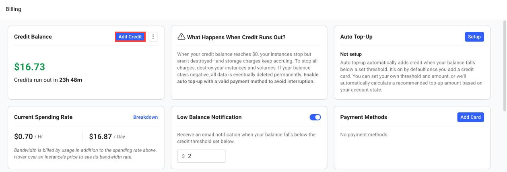

3. Sol menüden **Keys** bölümüne girin.
4. **SSH Keys** sekmesinde **+ New** butonuna tıklayın.
5. Kopyaladığınız `ssh-ed25519 ...` satırını kutuya yapıştırın ve **Save** butonuna basın.

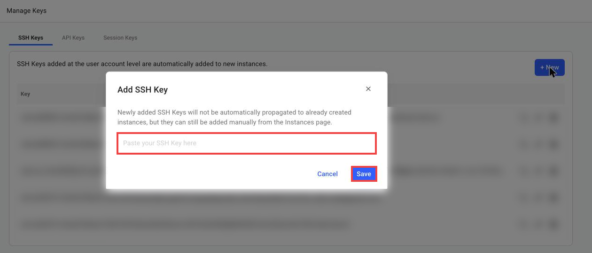

Hesaba eklenen anahtarlar, bundan sonra kiraladığınız bütün sunuculara otomatik olarak eklenir.
Anahtarı sunucuyu kiraladıktan sonra eklerseniz o sunucuya kendiliğinden eklenmez.

---

## 3. VM Kiralama

1. Sol menüden **Search** bölümüne girin.
2. Soldaki şablon kutusunda **Change Template** butonuna tıklayın.
3. Sağ üstteki **Tags** kısmından **VM** etiketini seçin.
4. **Ubuntu 22.04 VM** şablonunun altındaki ▶ butonuna tıklayın.

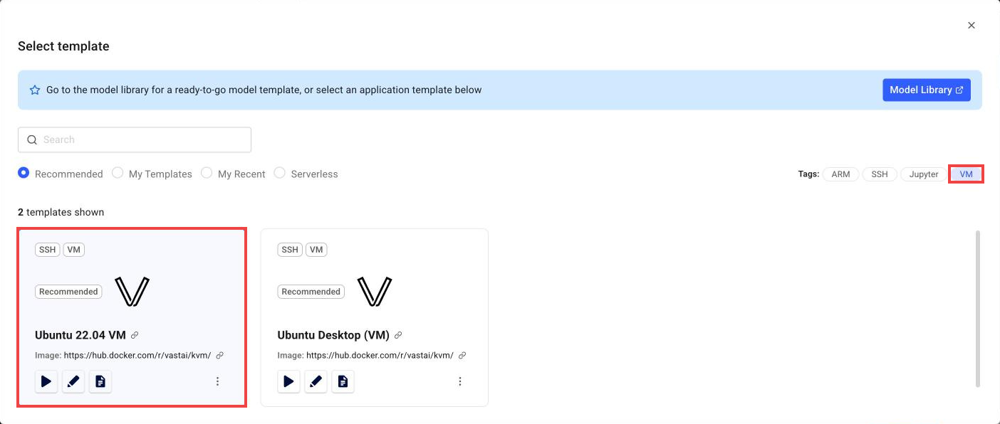

5. Üstteki filtrelerden **On-Demand**, GPU olarak **RTX 5060 Ti** veya **RTX 5090** ve bölgeyi
   seçin.
6. Makinenin `Max CUDA` değerinin `13.0` veya üzeri olduğunu kontrol edin.
7. Fiyatın üzerine gelerek saatlik toplam ücreti görün.

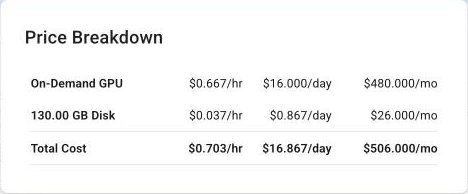

8. Uygun makinede **RENT** butonuna basın.

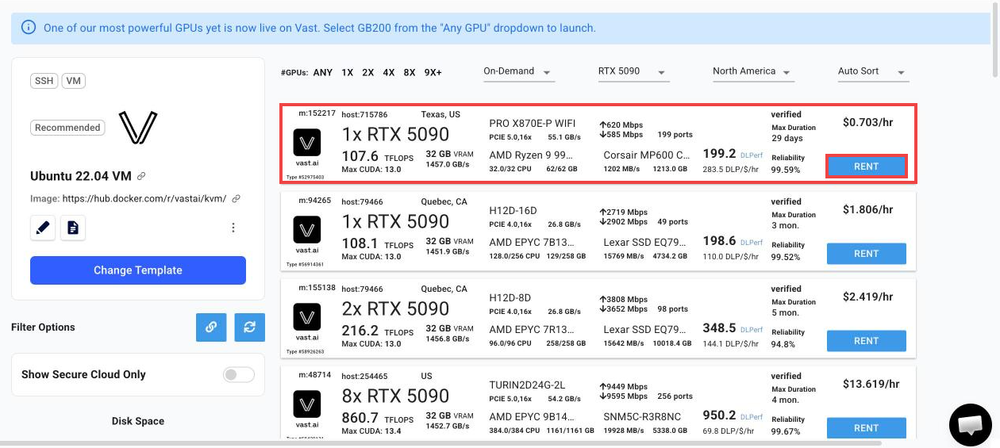

Makine seçerken şu değerlere bakın:

- GPU modeli ve adedi
- `Max CUDA` değeri (13.0 veya üzeri)
- Güvenilirlik oranı (Reliability)
- Saatlik toplam ücret ve internet ücreti
- Kiralanabilecek maksimum süre (Max Duration)

> [!IMPORTANT]
> **Stop**, GPU ücretini durdurur fakat disk ücreti devam eder. **Destroy** ise sunucuyu ve
> içindeki bütün dosyaları kalıcı olarak siler. Bakiyeniz biterse sunucu durur.

---

## 4. Sunucuya Bağlanma

1. Sol menüden **Instances** bölümüne girin.
2. Sunucunun açılmasını bekleyin. Vast, VM'lerin açılmasının 30 dakikayı bulabileceğini
   söylüyor. Testte RTX 5090 sunucusu 2 dakika içinde açıldı.
   Sunucu uzun süre açılmazsa veya durumu `exited` olursa onu **Destroy** ile silin ve başka
   bir makine kiralayın. İlk denediğim RTX 5060 Ti hiç açılmadı, ikincisi sorunsuz açıldı.
3. Sunucu açılınca **>_Connect** butonuna tıklayın.

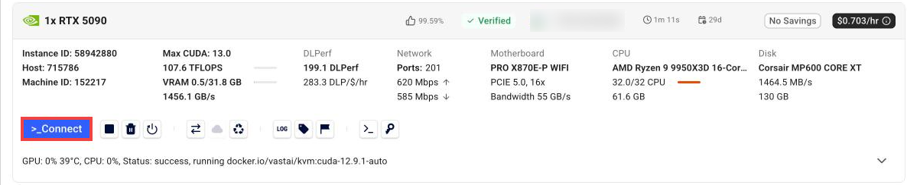

4. **Direct SSH Connect** satırındaki komutu kopyalayın.

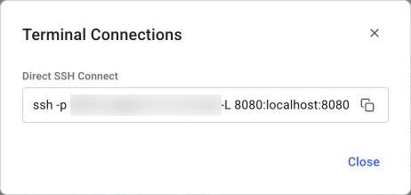

5. Komutu kendi bilgisayarınızın terminaline yapıştırın. Sondaki `-L 8080:localhost:8080`
   kısmı gerekli değildir, silebilirsiniz.

```bash
ssh -p PORT root@SUNUCU_IP
```

- `PORT` ve `SUNUCU_IP` kısımları Vast'ın verdiği komutta yazar.
- İlk bağlantıda `Are you sure you want to continue connecting (yes/no)?` sorusuna `yes` yazın.

Bundan sonraki bütün komutlar sunucuda çalıştırılır.

---

## 5. GPU ve Docker Kontrolü

```bash
nvidia-smi --query-gpu=name,driver_version,memory.total --format=csv
docker --version && docker compose version
```

Kartınızın adını, `580` veya üzeri bir sürücü sürümünü ve Docker sürümlerini görmelisiniz:

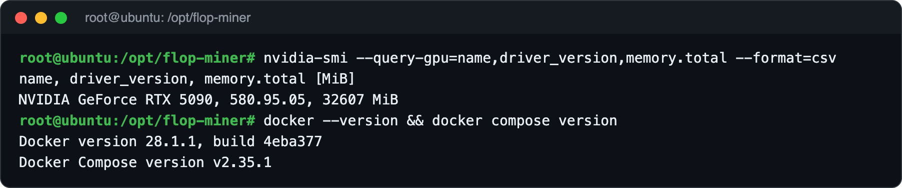

---

## 6. NVIDIA Container Toolkit Kurulumu

Vast VM'de Docker hazır gelir, fakat ekran kartını Docker'a bağlayan araç eksiktir. Bu araç
olmadan programlar GPU'yu göremez ve şu hatayı alırsınız:
`could not select device driver "" with capabilities: [[gpu]]`

```bash
apt-get update && apt-get install -y nvidia-container-toolkit
nvidia-ctk runtime configure --runtime=docker
systemctl restart docker
```

GPU'nun Docker içinden göründüğünü test edin:

```bash
docker run --rm --gpus all nvidia/cuda:13.0.1-base-ubuntu22.04 nvidia-smi --query-gpu=name,driver_version,memory.total --format=csv
```

Son satırda kartınızın adını görüyorsanız bu adım tamamdır:

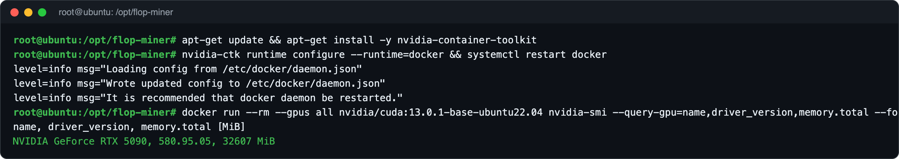

---

## 7. Rehber Dosyalarını İndirme ve Ayar Dosyasını Hazırlama

```bash
cd ~
git clone https://github.com/UfukNode/flop-miner-setup.git
mkdir -p /opt/flop-miner/models
cp flop-miner-setup/docker-compose.yml flop-miner-setup/miner.env.example flop-miner-setup/sponsor.mjs /opt/flop-miner/
cd /opt/flop-miner
install -m 600 miner.env.example miner.env
```

Ayar dosyasındaki gizli değerleri oluşturun ve miner'ınıza bir isim verin:

```bash
sed -i "s/^INFERENCE_API_KEY=.*/INFERENCE_API_KEY=$(openssl rand -hex 32)/" miner.env
sed -i "s/^SESSION_AUTH_TOKEN=.*/SESSION_AUTH_TOKEN=$(openssl rand -hex 32)/" miner.env
sed -i "s/^WORKER_NAME=.*/WORKER_NAME=miner-ismi-girin/" miner.env
```

- `miner-ismi-girin` yerine miner'ınız için bir isim yazın. Harf, rakam ve tire kullanın.

Sonraki adımlarda kullanacağımız iki kısayolu ekleyin:

```bash
cat >> ~/.bashrc <<'EOF'
export FLOP_CLI="$(grep '^FLOP_CLI=' /opt/flop-miner/miner.env 2>/dev/null | cut -d= -f2-)"
compose() { docker compose --env-file /opt/flop-miner/miner.env -f /opt/flop-miner/docker-compose.yml "$@"; }
flop() { docker run --rm --network host -e FLOP_KEY_PASSWORD -v /opt/flop-miner:/work "$FLOP_CLI" "$@"; }
EOF
source ~/.bashrc
```

- `compose`: miner programlarını (backend ve worker) yönetir.
- `flop`: FLOP'un resmi komut aracıdır. `/opt/flop-miner` klasörü bu aracın içinde `/work`
  olarak görünür.

---

## 8. FLOP Programlarını İndirme

```bash
docker pull "$FLOP_CLI"
compose pull
```

Model programı (`miner-vllm-toploc`) 23 GB'tır. Testte üç programın inmesi 3,5 dakika sürdü.

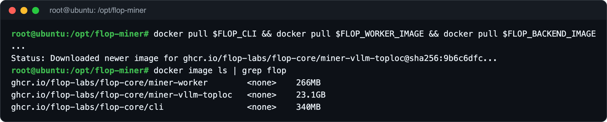

---

## 9. Miner Cüzdanı Oluşturma

Miner'ın kendine ait bir hesabı olur. İşlerin imzası ve stake bu hesaba bağlıdır.

```bash
cd /opt/flop-miner
umask 077
flop keys generate --type sr25519 --show-secret --json > /root/miner-key.json
jq -r .mnemonic /root/miner-key.json > /opt/flop-miner/signer
chmod 600 /opt/flop-miner/signer
jq -r .address /root/miner-key.json
```

Son komut miner adresinizi yazar (`5` ile başlar). Bu adresi bir yere kaydedin.

24 kelimeyi bir kez ekrana yazdırıp kağıda not edin, ardından geçici dosyayı silin:

```bash
cat /opt/flop-miner/signer
rm /root/miner-key.json
```

Oturum anahtarını oluşturun:

```bash
install -d -m 700 /opt/flop-miner/session-keys
sh -c 'umask 077; openssl rand -hex 32 > /opt/flop-miner/session-keys/enclave.seed'
```

> [!CAUTION]
> `signer` dosyası miner hesabınızın kendisidir. Kimseye göndermeyin, ekran görüntüsünü
> almayın ve GitHub'a yüklemeyin. Worker bu dosyayı bulamazsa FLOP'un herkese açık test
> hesabı `//Alice` ile çalışmaya kalkar. 14. adımda log'daki `Signer:` satırında kendi
> adresinizi gördüğünüzden emin olun.

---

## 10. Stake Sponsoru ile Kayıt

FLOP, devnet'te miner stake'ini kendisi karşılar. Bu komut miner hesabınızla bir istek
imzalar ve FLOP'un sponsor servisine gönderir. Sponsor hesabınızı miner olarak kaydeder ve
stake'i yatırır.

```bash
docker run --rm -v /opt/flop-miner:/work --entrypoint node "$FLOP_CLI" /work/sponsor.mjs
```

`HTTP 200` ve `"success":true` görüyorsanız kayıt tamamdır. Ağ hesabınıza 1.000.000 test FLOP
stake ve işlem ücretleri için 250 test FLOP yatırır:

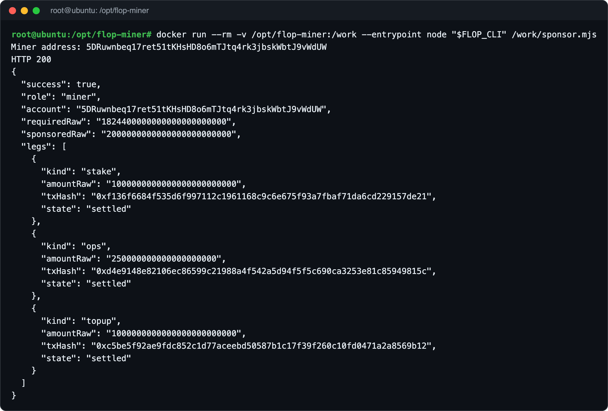

- Kendiniz `flop miner register` çalıştırmayın. Sponsor sizi zaten kaydeder.
- `429` ve `automatic miner sponsorship is full` mesajı sponsorun o an dolu olduğunu gösterir.
  Aynı anda en fazla 40 sponsorlu miner kalibrasyon bekleyebilir, sponsor günde en fazla 100
  yeni miner kabul eder. Biri kalibre olunca yer açılır. Bir süre sonra aynı komutu tekrar
  çalıştırın. `503` gelirse de bir süre sonra tekrar deneyin.
- Kayıtlı bir miner kalibre olana kadar bu yerlerden birini tutar. Bu yüzden bu adımdan sonra
  kuruluma ara vermeden devam edin.
- Hızlı kartlar daha fazla stake ister. Aynı komutu bir kez daha çalıştırırsanız sponsor
  stake'i en fazla 2.000.000 test FLOP'a tamamlar. Testte RTX 5060 Ti'ye 1.000.000 yetti,
  RTX 5090 için ikinci istek gerekti.

---

## 11. Modeli İndirme ve Doğrulama

FLOP'un aracı modeli indirir ve dosyaları zincirdeki kayıtla karşılaştırır. Kayıtla birebir
aynı değilse dosyaları yazmaz.

```bash
flop --network devnet --rpc wss://rpc.devnet.flop.network model fetch 0x1a52c1abe781db051e70ae357f72bb70161ca0c092df0b618f22a9292ba63306 --precision BF16 --output-dir /work/models/qwen2.5-0.5b-instruct --json
```

`"ok": true` ve `verified_root` değerinin model hash'iyle aynı olduğunu görmelisiniz (başındaki
`0x` olmadan). Görseldeki çıktı eski CLI'ya ait, orada bu değerin adı `computed_root`:

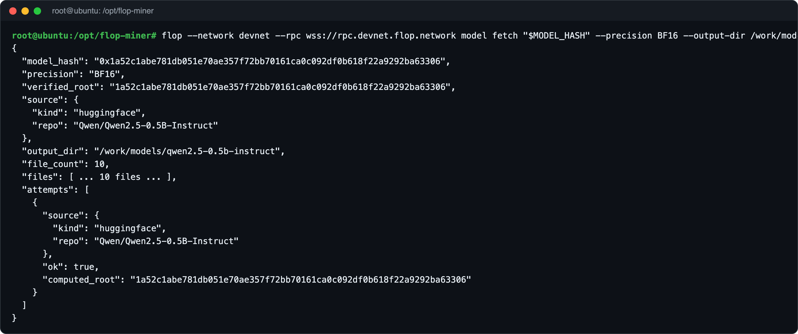

İlk denemede `MODEL_VERIFICATION_FAILED` ve `fetch failed` hatası alırsanız aynı komutu tekrar
çalıştırın. Testte ilk deneme bu hatayı verdi, ikinci deneme başarılı oldu.

Hata `Unsupported runtime spec version` diyorsa CLI'nız zincirden eski kalmıştır:
[bu düzeltmeyi](#unsupported-runtime-spec-version-1014014) uygulayın.

---

## 12. Backend'i Başlatma

```bash
cd /opt/flop-miner
compose up -d backend
compose logs -f backend
```

Logda `MODEL_DIR reproduces MODEL_HASH` ve `Uvicorn running` satırlarını gördüğünüzde model
GPU'ya yüklenmiş demektir. Loglardan `CTRL + C` ile çıkabilirsiniz, program çalışmaya devam
eder.

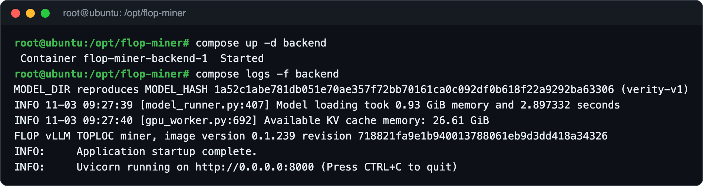

Backend'in sağlık kontrolünü yapın:

```bash
compose exec -T backend python3 -c 'import os, json, urllib.request as u; r=json.loads(u.urlopen(u.Request("http://127.0.0.1:8000/health", headers={"Authorization": "Bearer " + os.environ["INFERENCE_API_KEY"]})).read()); print(json.dumps({k: r.get(k) for k in ("model_identity","model_hash","precision","decode_policy_hash","image")}, indent=2))'
```

`model_identity` değeri `measured` olmalı ve model hash'i 11. adımdakiyle aynı olmalıdır:

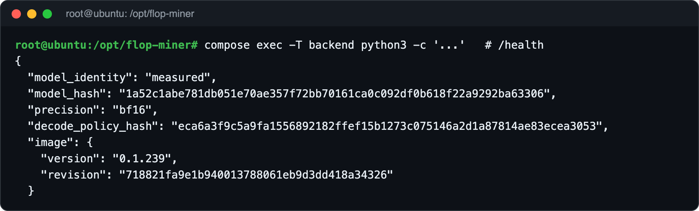

---

## 13. HTTPS Tünel Kurulumu

Ağın miner'ınıza ulaşabilmesi için bir HTTPS adresi gerekir. Vast'ta 80 ve 443 portlarını
doğrudan açamadığımız için Cloudflare'in ücretsiz tünelini kullanacağız. Hesap açmanız
gerekmez.

```bash
cd ~
curl -fsSL -o cloudflared.deb https://github.com/cloudflare/cloudflared/releases/latest/download/cloudflared-linux-amd64.deb
dpkg -i cloudflared.deb
```

Tüneli sunucu yeniden başlasa bile çalışacak bir servis olarak kurun:

```bash
sudo tee /etc/systemd/system/flop-tunnel.service > /dev/null <<'EOF'
[Unit]
Description=FLOP miner HTTPS tunnel
After=network-online.target
Wants=network-online.target

[Service]
ExecStart=/usr/bin/cloudflared tunnel --no-autoupdate --url http://127.0.0.1:8645
Restart=always
RestartSec=5

[Install]
WantedBy=multi-user.target
EOF
systemctl daemon-reload
systemctl enable --now flop-tunnel
```

Birkaç saniye bekleyip tünel adresinizi görün:

```bash
journalctl -u flop-tunnel --no-pager | grep -o 'https://[a-z0-9-]*\.trycloudflare\.com' | tail -1
```

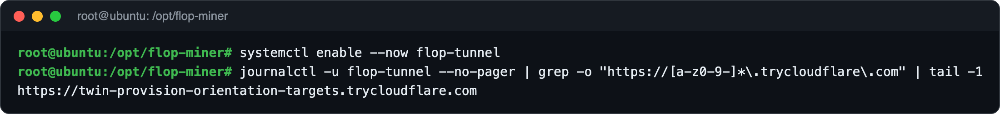

Adresi ayar dosyasına yazın:

```bash
H=$(journalctl -u flop-tunnel --no-pager | grep -o '[a-z0-9-]*\.trycloudflare\.com' | tail -1)
sed -i "s/^SESSION_PUBLIC_HOST=.*/SESSION_PUBLIC_HOST=$H/" /opt/flop-miner/miner.env
grep '^SESSION_PUBLIC_HOST=' /opt/flop-miner/miner.env
```

> [!NOTE]
> Bu ücretsiz tünelin adresi tünel yeniden başladığında değişir. Değişirse son üç komutu
> tekrar çalıştırın ve worker'ı `compose up -d worker` ile yeniden başlatın.

---

## 14. Worker'ı Başlatma

```bash
cd /opt/flop-miner
compose up -d worker
compose logs -f worker
```

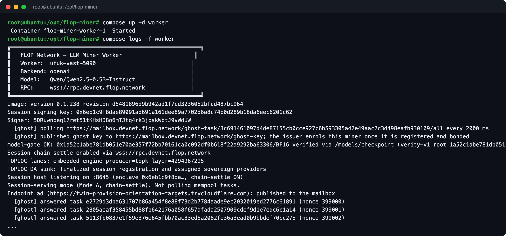

Logda şu satırları kontrol edin:

| Satır | Anlamı |
| --- | --- |
| `Signer: 5...` | 9. adımda oluşturduğunuz miner adresi olmalı |
| `[ghost] published ghost key` | Ağın test işlerini göndereceği anahtar yayınlandı |
| `model-gate OK` | Model, zincirdeki kayıtla aynı |
| `Session host listening on :8645` | Worker istekleri dinliyor |
| `Endpoint ad (...): published to the mailbox` | Tünel adresiniz ağa duyuruldu |
| `[ghost] answered task ...` | Ağın gönderdiği test işleri cevaplanıyor |

---

## 15. Kontrol Etme

Kendi bilgisayarınızdan tünel adresinize bir istek gönderin:

```bash
curl -s -o /dev/null -w "%{http_code}\n" https://TUNEL-ADRESINIZ/session/info
```

`401` cevabı normaldir. Adres çalışıyor ve şifresiz isteği reddediyor demektir.

Miner'ın zincirdeki durumuna bakın:

```bash
flop --network devnet --rpc wss://rpc.devnet.flop.network miner status MINER_ADRESINIZ
```

`registered` değeri `true` olmalı ve `stake` kısmında sponsorun yatırdığı stake görünmelidir:

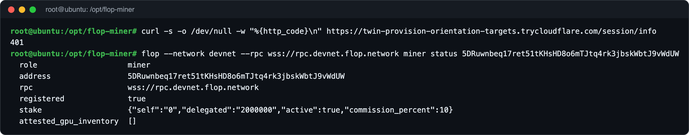

Explorer'da hesabınızı açın:

```text
https://explorer.devnet.flop.network/account/MINER_ADRESINIZ
```

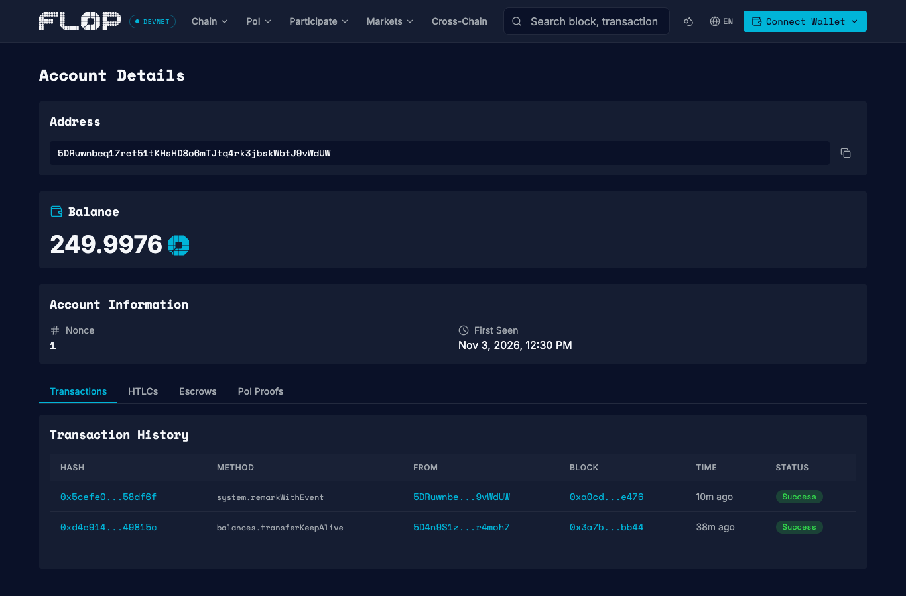

---

## 16. GPU Bilgisini Zincire Yazma (İsteğe Bağlı)

Explorer'ın miner listesinde kartınızın görünmesi için GPU bilgisini zincire yazabilirsiniz.
Bunun için önce miner anahtarınızı şifreli bir dosyaya aktarın. Bir şifre belirleyin ve
yazdığınız şifreyi unutmayın:

```bash
cd /opt/flop-miner
read -r -s -p 'Keystore şifresi: ' FLOP_KEY_PASSWORD && export FLOP_KEY_PASSWORD && echo
MINER_SECRET="$(cat /opt/flop-miner/signer)" docker run --rm --network host -e MINER_SECRET -e FLOP_KEY_PASSWORD -v /opt/flop-miner:/work "$FLOP_CLI" keys import --type sr25519 --secret-env MINER_SECRET --out /work/miner.json --password-env FLOP_KEY_PASSWORD
```

GPU bilgisini yazın:

```bash
nvidia-smi --query-gpu=name,memory.total --format=csv,noheader,nounits | docker run -i --rm --network host -e FLOP_KEY_PASSWORD -v /opt/flop-miner:/work "$FLOP_CLI" --network devnet --rpc wss://rpc.devnet.flop.network --keystore /work/miner.json --password-env FLOP_KEY_PASSWORD miner declare-gpu --nvidia-smi -
```

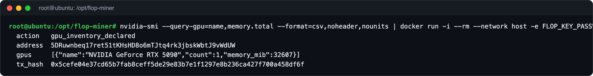

İşlem ücreti sponsorun verdiği 250 FLOP'tan düşer. Testte ücret 0,0024 FLOP oldu.

---

## 17. Kalibrasyonu Takip Etme

Ağ, miner'ınızın gerçekten ne kadar iş yapabildiğini ölçmek için ona test işleri gönderir
(logdaki `[ghost] answered task` satırları). Yeterli sayıda iş doğrulanınca worker şu satırı
yazar:

```text
[calibration] ... cap accepted: ... GFLOP/s from ... verified jobs
```

Zincirdeki güncel kurala göre bunun için en az 600 blokluk (yaklaşık 11 dakika) bir süre
içinde en az 64 doğrulanmış iş gerekir. Ölçüm haftada bir yenilenir.

```bash
compose logs worker | grep -E "answered task|calibration" | tail
flop --network devnet --rpc wss://rpc.devnet.flop.network miner status MINER_ADRESINIZ --json | jq .calibration
```

Testte kalibrasyon, worker açıldıktan yaklaşık 12 dakika sonra kabul edildi: RTX 5090'da 621
blok içinde 64 doğrulanmış iş ve 200 GFLOP/s, RTX 5060 Ti'de 618 blok içinde 64 doğrulanmış iş
ve 130 GFLOP/s. `calibration` alanı `null` yerine bu bilgileri gösteriyorsa
miner'ınız hazırdır:

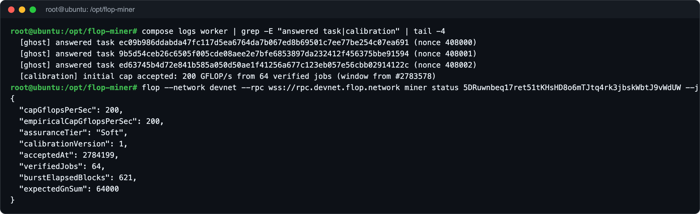

Explorer'da **PoI** menüsünden **Mining** sayfasına girip **Calibration** sekmesini açtığınızda
miner'ınızı `Active` olarak görürsünüz: https://explorer.devnet.flop.network/mining

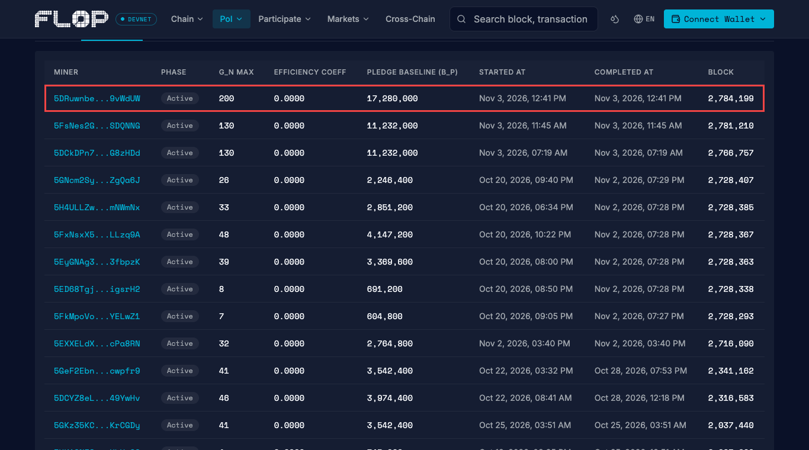

> [!IMPORTANT]
> Worker'ı açık tutun. Ağın gönderdiği bir test işi 600 blok içinde cevaplanmazsa süresi dolar
> ve miner'ın stake'inden kesinti (slash) yapılır.

Kalibrasyon sırasında stake yetmezse 10. adımdaki sponsor komutunu tekrar çalıştırın.

Kalibrasyondan sonra ağ, miner'ınıza ücretli oturumlar göndermeye başlar. Biten bir oturum worker
logunda `[session] settle cooperative` satırıyla görünür ve ödeme test FLOP olarak miner
hesabınıza geçer:

```bash
compose logs worker | grep -E "\[session\] (open|settle|error)" | tail
```

> [!NOTE]
> Bir oturumun her turu, kanıt kaydı için yaklaşık 1,31 test FLOP işlem ücreti tutar. Bu, küçük
> bir oturumun ödediğinden fazladır ([#163](https://github.com/flop-labs/network/issues/163)).
> Gördüğümüz trafikle sponsorun ücretler için verdiği 250 test FLOP 2-3 gün yetiyor ve
> FLOP'un sponsorlu hesaplara tekrar yükleme yolu henüz yok
> ([#175](https://github.com/flop-labs/network/issues/175)).

---

## 18. Kilit Açıcıyı Kurma

Worker gönderdiği bir işlemin sonucunu doğrulayamazsa, örneğin sonucu beklerken RPC bağlantısı
koparsa, güvenlik için kendini kilitler. Logda `miner signer is fenced` yazar, yeni oturumlar
`503` alır ve miner ödeme almaz. Bu kilit kendiliğinden hiç açılmaz, worker'ı yeniden başlatmak
da açmaz.

Bu açıcı worker'ı 2 dakikada bir kontrol eder. Worker kilitliyse, takılan işlemin zincire hâlâ
girip giremeyeceğine zincirden bakar. Yalnızca giremeyeceği kesinleşince kilit dosyasının bir
kopyasını saklar, kilidi kaldırır ve worker'ı yeniden başlatır.

```bash
U=https://raw.githubusercontent.com/UfukNode/flop-miner-setup/main/fence-guard
install -d -m 700 /opt/flop-miner/fence-guard
cd /opt/flop-miner/fence-guard
curl -fsSL --remote-name-all "$U"/{fence-guard.sh,status.mjs,recover.mjs,reconcile.mjs}
chmod +x fence-guard.sh
curl -fsSL -o /etc/systemd/system/flop-fence-guard.service "$U/flop-fence-guard.service"
curl -fsSL -o /etc/systemd/system/flop-fence-guard.timer "$U/flop-fence-guard.timer"
systemctl daemon-reload
systemctl enable --now flop-fence-guard.timer
```

Çalıştığını ve worker'ın kilitli olmadığını kontrol edin:

```bash
systemctl list-timers flop-fence-guard.timer --no-pager
compose exec -T worker node --input-type=module < status.mjs | jq .
```

Zamanlayıcı bir sonraki çalışma saatini göstermelidir. `"fenced": false`, worker'ın kilitli
olmadığını gösterir:

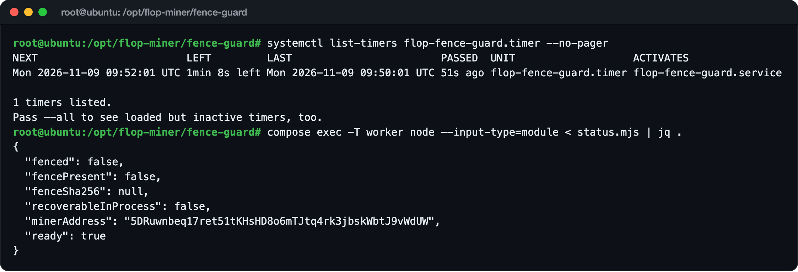

- Açıcı kilidi yalnızca takılan işlemin zincirdeki ömrü (512 blok, yaklaşık 9 dakika) dolunca,
  miner hesabından bekleyen işlem kalmayınca ve açık oturum olmayınca açar. Açık oturumları en
  fazla 90 dakika bekler. Kilit genellikle 20 dakika içinde açılır. Açıcı yaptıklarını
  `/opt/flop-miner/fence-guard/guard.log` dosyasına yazar.
- Açıcı worker v0.1.286 ister, bu rehberdeki sürüm de budur. Kurulumu 8 Kasım'dan önce
  yaptıysanız önce [bu düzeltmeyi](#v2-leaf-cannot-bind-a-toploc-activation-commitment-fail-closed)
  uygulayın.

---

## 19. Worker v0.1.286 Hız Yaması

Worker v0.1.286 her oturum açılışında ve her turda baştan bir kalibrasyon kontrolü yapar. Bu
kontrol bütün miner'ların kalibrasyon işlerini FLOP'un herkese açık RPC'sinden okur ve testimizde
13-28 saniye sürdü. FLOP'un ağ geçidi bu kadar beklemeyip birçok oturumu bırakıyor, bu oturumlar
da explorer'da `Closed` görünüyor. FLOP bunu henüz yayınlanmamış yeni bir worker sürümünde
düzeltti ([#168](https://github.com/flop-labs/network/issues/168)).

O zamana kadar bu betik, worker'ın zaten 30 saniyede bir yenilediği kalibrasyon bilgisini
kullanmasını sağlar. Ayrıca başarısız bir kanıt yüklemesinde kayıt ücretinin iki kez ödenmesini
önler ve kanıtın geri okunmasını bir kez daha dener
([#172](https://github.com/flop-labs/network/issues/172)).

```bash
cd /opt/flop-miner
curl -fsSL -o patch-worker.sh https://raw.githubusercontent.com/UfukNode/flop-miner-setup/main/worker-patch/patch-worker.sh
bash patch-worker.sh
```

Worker'ın yamalı dosyayı çalıştırdığını kontrol edin:

```bash
compose exec -T worker sha256sum /repo/sdk/miner-worker/miner-worker.mjs
```

Çıkan değer `patched file:` satırıyla aynı olmalıdır:

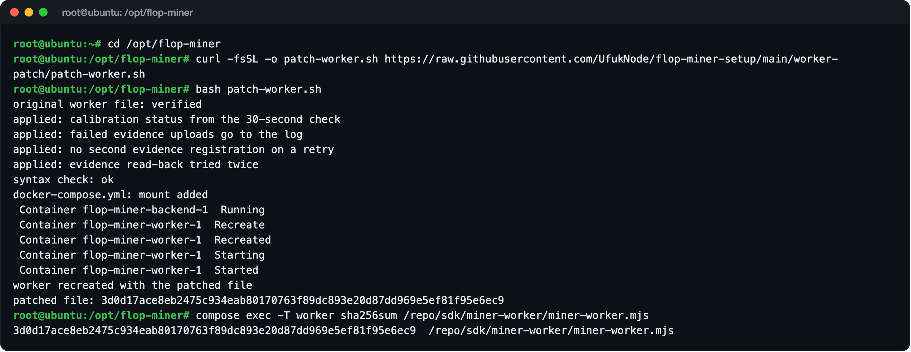

- Betik yalnızca worker v0.1.286 ile çalışır. Bir şeyi değiştirmeden önce FLOP'un orijinal
  dosyasını doğrular ve bir kopyasını `/opt/flop-miner/patches` klasöründe saklar.
- Daha yeni bir worker'a geçmeden önce yamayı geri alın:
  `bash /opt/flop-miner/patch-worker.sh --undo`

---

## Kullanacağınız Komutlar

### Worker logunu izle

```bash
compose logs -f worker
```

### Backend logunu izle

```bash
compose logs -f backend
```

### Programların durumu

```bash
compose ps
```

### Worker'ı yeniden başlat

```bash
compose restart worker
```

### Programları durdur ve başlat

```bash
compose stop
compose up -d
```

### Tünelin durumu

```bash
systemctl status flop-tunnel
```

### GPU'yu izle

```bash
nvidia-smi
```

Loglardan `CTRL + C` ile çıkabilirsiniz, programlar çalışmaya devam eder.

---

## Sürüm Güncelleme

1. 19. adımı uyguladıysanız önce yamayı geri alın: `bash /opt/flop-miner/patch-worker.sh --undo`.
   Yama yalnızca worker v0.1.286 içindir.
2. https://flop.network/releases.json adresinden `cli`, `miner-worker` ve `miner-vllm-toploc`
   için yeni `image` değerlerini alın. Bu liste zincirin gerisinde kalabilir: 7 Kasım 2026'da
   hâlâ artık çalışmayan CLI v0.1.220'yi gösteriyordu. Emin değilseniz bu rehberin
   `miner.env.example` dosyasındaki satırları kullanın.
3. `/opt/flop-miner/miner.env` içindeki `FLOP_CLI`, `FLOP_WORKER_IMAGE` ve
   `FLOP_BACKEND_IMAGE` satırlarını değiştirin.
4. Yeni sürümleri indirip programları yeniden başlatın:

```bash
source ~/.bashrc && docker pull "$FLOP_CLI" && compose pull && compose up -d
```

`signer` dosyasını, `session-keys` klasörünü ve `worker-data` alanını koruyun.
`compose down -v` komutunu kullanmayın, kalibrasyon bilgileri silinir.

---

## Vast.ai Sunucusunu Kapatmadan Önce

- `/opt/flop-miner/signer` içindeki 24 kelimenin ve `session-keys/enclave.seed` dosyasının
  yedeğini aldığınızdan emin olun.
- **Stop** GPU ücretini durdurur, disk ücreti devam eder.
- **Destroy** sunucuyu ve bütün dosyaları siler. Stake miner hesabınızda kalır. Aynı `signer`
  ile yeni bir sunucuda devam edebilirsiniz. Sponsor her hesaba bir kez kayıt yapar.

---

## ! Sık Karşılaşılan Hatalar

### `Unsupported runtime spec version 1014014`

Devnet 7 Kasım 2026'da yeni bir runtime sürümüne geçti ve CLI v0.1.220 bu sürümü okuyamıyor.
Yeni CLI'yı ayar dosyanıza yazıp indirin:

```bash
sed -i 's#^FLOP_CLI=.*#FLOP_CLI=ghcr.io/flop-labs/flop-core/cli:v0.1.290@sha256:24e32b034b0d3600ee28127dad30d4228e623235f2dc62da34c2c85ba5e21a88#' /opt/flop-miner/miner.env
source ~/.bashrc
docker pull "$FLOP_CLI"
```

Ardından hata veren adımı tekrar çalıştırın. Worker ve backend için bir değişiklik gerekmez.

### `V2 leaf cannot bind a TOPLOC activation commitment (fail closed)`

Oturumlar açılıyor fakat miner hiç ödeme almıyor ve worker logunda bu hata görünüyor. Worker'da
`SESSION_COMMIT_IDS` ayarı eksiktir. Ayarı ekleyin, worker v0.1.286'ya geçin ve worker'ı yeniden
başlatın:

```bash
cd /opt/flop-miner
grep -q SESSION_COMMIT_IDS docker-compose.yml || sed -i 's/^      SESSION_CHAIN: "1"$/&\n      SESSION_COMMIT_IDS: "1"/' docker-compose.yml
sed -i 's#^FLOP_WORKER_IMAGE=.*#FLOP_WORKER_IMAGE=ghcr.io/flop-labs/flop-core/miner-worker:v0.1.286@sha256:78211fe5f63820eeb1191e834f3a1eb7f573bc34348bdd4c0b0f07c7824fe7b5#' miner.env
compose pull worker
compose up -d worker
compose exec -T worker printenv SESSION_COMMIT_IDS
```

Son komut `1` yazmalıdır. Testte bu değişiklikten sonraki ilk oturum, açıldıktan yaklaşık bir
dakika sonra ödendi.

### `miner signer is fenced`

Worker bir işlemin sonucunu doğrulayamadığı için kendini kilitlemiştir, bu yüzden yeni oturumlar
`503` alır. Yeniden başlatmak kilidi açmaz. FLOP'un kendi talimatları da kilit dosyasının elle
silinmemesini söyler. [18. adımdaki](#18-kilit-açıcıyı-kurma) açıcıyı kurun. Açıcı, zincir
güvenli olduğunu gösterince kilidi açar, bu genellikle 20 dakika içinde olur. Ne yaptığını görmek
için:

```bash
tail /opt/flop-miner/fence-guard/guard.log
```

Logda `BLOCKED, needs a person` yazıyorsa açıcı beklenmeyen bir durum bulmuştur ya da kilidi son
6 saatte zaten 3 kez açmıştır, bu yüzden kilide dokunmaz. Dosyayı silmeyin, durumu
https://github.com/flop-labs/network adresine bildirin.

### `could not select device driver "" with capabilities: [[gpu]]`

NVIDIA Container Toolkit kurulu değil. 6. adımı uygulayın.

### `MODEL_VERIFICATION_FAILED` ve `fetch failed`

İndirme sırasında geçici bir bağlantı hatası oldu. Aynı komutu tekrar çalıştırın. Mesajda
`Unsupported runtime spec version` yazıyorsa bu bölümdeki ilk düzeltmeyi uygulayın.

### Worker logunda `Signer:` satırında başka bir adres var

Worker `signer` dosyasını bulamamıştır. Dosyanın `/opt/flop-miner/signer` yolunda olduğunu,
sahibinin `root` ve izninin `600` olduğunu kontrol edin:

```bash
ls -la /opt/flop-miner/signer
```

### Sponsor `403`, `429` veya `503` dönüyor

`403`: hesap kabul edilmedi. `429`: sponsor dolu. Mesajda `automatic miner sponsorship is
full` yazıyorsa kalibrasyon bekleyen sponsorlu miner sayısı sınıra (40) ulaşmıştır. Biri
kalibre olunca yer açılır, bir süre sonra tekrar deneyin. Mesaj günlük sınırdan söz ediyorsa
ertesi gün deneyin. `503`: servis geçici olarak cevap vermiyor, bir süre sonra deneyin.

### `SESSION_PUBLIC_HOST must be a lowercase DNS name`

`miner.env` içindeki adresi başında `https://` olmadan ve küçük harflerle yazın.

### Backend açılmıyor

`nvidia-smi` çıktısında sürücünün 580 veya üzeri, CUDA'nın 13.0 veya üzeri olduğunu kontrol
edin. Daha eski sürücülü bir makinede bu program çalışmaz.

### `/session/open` isteği `503` dönüyor

Miner henüz kalibre olmamıştır. Kalibrasyon tamamlanana kadar bu normaldir. Cevapta
`miner signer is fenced` yazıyorsa [bu maddeye](#miner-signer-is-fenced) bakın.

### Explorer'da oturumların çoğu `Closed` görünüyor

Bunların çoğu, FLOP'un ağ geçidinin neredeyse hiç para koymadan açtığı deneme oturumlarıdır
(explorer'da `0.0000 FLOP`). Devnet'te 48 saatte 153 miner'a bunlardan yaklaşık 9.000 tane açıldı
ve hiçbir miner'da hiçbiri ödenmedi, yani bunlar için yapılacak bir şey yoktur. Gerçek para olan
oturumlar da kapanıyorsa [19. adımı](#19-worker-v01286-hız-yaması) uygulayın.

---

## Güvenlik

- Miner için ayrı bir hesap kullanın. Ana cüzdanınızı hiçbir sunucuya koymayın.
- `signer`, `miner.json`, keystore şifresi, `SESSION_AUTH_TOKEN` ve `INFERENCE_API_KEY`
  sunucuda kalır. Bunları kimseyle paylaşmayın.
- Worker'ın 8645 portu ve backend'in 8000 portu dışarıya açılmaz. Dışarıdan yalnızca tünel
  adresi görünür ve şifresiz istekleri reddeder.
- FLOP hiçbir zaman seed phrase istemez. FLOP'un resmi Discord veya Telegram kanalı yoktur.
- Herhangi bir linke güvenmeden önce https://flop.finance/official/ sayfasıyla karşılaştırın.

---

## Test Notları

Bu rehber 3 Kasım 2026'da iki gerçek Vast.ai sunucusunda baştan sona denendi:

| Test | RTX 5090 | RTX 5060 Ti |
| --- | --- | --- |
| Sunucu | Ubuntu 22.04 VM, Teksas, 30 vCPU, 47 GB RAM | Ubuntu 22.04 VM, Quebec, 9 vCPU, 36 GB RAM |
| GPU | 32 GB VRAM | 16 GB VRAM |
| Sürücü | 580.95.05, CUDA 13.0 | 580.95.05, CUDA 13.0 |
| Programların inmesi | 3,5 dakika | Yaklaşık 10 dakika |
| Model doğrulama | Kök değer zincirdeki kayıtla eşleşti | Kök değer zincirdeki kayıtla eşleşti |
| Sponsor kaydı | İlk istekte kabul edildi | İlk istek `429` döndü (sıra doluydu), 16 dakika sonra kabul edildi |
| Stake | İkinci istekte 2.000.000 FLOP'a tamamlandı | 1.000.000 FLOP yetti |
| Backend | vLLM 0.31.0, KV önbellek 26,61 GiB | vLLM 0.31.0, KV önbellek 12,38 GiB |
| Worker | İlk dakikada 72 test işi cevaplandı | İlk 2 dakikada 47 test işi cevaplandı |
| Dışarıdan kontrol | Şifresiz istek `401` döndü | Şifresiz istek `401` döndü |
| GPU bildirimi | Zincire yazıldı, ücret 0,0024 FLOP | Denenmedi |
| Kalibrasyon | 12 dakikada kabul edildi: 64 iş, 621 blok, 200 GFLOP/s, `Soft` | 12 dakikada kabul edildi: 64 iş, 618 blok, 130 GFLOP/s, `Soft` |
| Kurulum süresi | Yaklaşık 25 dakika | Yaklaşık 45 dakika (16 dakikası sponsor sırası) |
| Disk kullanımı | 31 GB | 32 GB |
| Maliyet | Saatte 0,703 dolar, internet GB başına 0,005 dolar | Saatte 0,197 dolar, internet GB başına 0,02 dolar |

7 Kasım 2026'da, zincir 1014014 runtime sürümüne geçtikten sonra CLI v0.1.290 yeniden denendi:
anahtar oluşturma ve içe aktarma, `model fetch` (doğrulanan kök model hash'iyle aynı, 10 dosya),
`miner status` ve `miner declare-gpu --dry-run` çalıştı. CLI v0.1.220 ise
`Unsupported runtime spec version 1014014` hatasıyla durdu.

8 Kasım 2026'da eksik `SESSION_COMMIT_IDS` ayarı bulundu. Önceki 48 saatte RTX 5060 Ti miner'ı
42 oturum açtı, bunların 28'i `V2 leaf cannot bind a TOPLOC activation commitment (fail closed)`
hatasıyla durdu ve hiçbiri ödenmedi. Ayar eklenip worker v0.1.286'ya geçildikten sonra ilk oturum,
açıldıktan yaklaşık bir dakika sonra ödendi. 9 Kasım'da Türkiye saatiyle 06:21'e kadar 7 oturum
ödendi (3,15 test FLOP).

9 Kasım 2026'da Türkiye saatiyle 06:45'te worker bir oturumun ödeme işlemini gönderirken RPC
bağlantısı koptu ve worker kendini kilitledi. Yaklaşık 4 saat oturum almadı. 18. adımdaki açıcı,
işlemin zincire hiç girmediğini ve artık giremeyeceğini zincirden doğruladı ve kilidi 10:54'te
açtı. Sonraki oturum 2 dakika sonra açıldı ve 10:57'de ödendi.

10 Kasım 2026'da FLOP'un ağ geçidi oturum açılışlarının birçoğunu yarıda kesiyordu (Türkiye
saatiyle 14:00'e kadar 20 tane) ve oturumun açılışından ilk tura kadar geçen ortanca süre 14,8
saniyeye çıkmıştı. Sunucuda ölçüldüğünde worker'ın oturum kapısı orijinal dosyayla 13-28 saniye,
yamayla (19. adım) 8-84 milisaniye sürdü. Yamadan sonra ilk tur açılıştan 4-5 saniye sonra geldi
ve sonraki oturumlar ödendi.

---

## Resmi Kaynaklar

- FLOP Miner Dokümanı: https://docs.flop.network/docs/run-miner
- GPU Sahipleri İçin Başlangıç: https://docs.flop.network/docs/run-gpu-provider
- Explorer Miner Sayfası: https://explorer.devnet.flop.network/miner
- Yayın Listesi: https://flop.network/releases.json
- Hata Bildirimi: https://github.com/flop-labs/network
- Resmi Linkler: https://flop.finance/official/

---

## Disclaimer

Bu rehber yatırım tavsiyesi değildir ve FLOP Labs'in resmi rehberi değildir. Devnet ödül
vermez ve sıfırlanabilir. GPU kiralama, disk ve internet masrafları size aittir. Komutları
çalıştırmadan önce FLOP'un resmi dokümanındaki güncel sürümleri kontrol edin.

---

Hazırlayan: [@UfukDegen](https://x.com/UfukDegen)
Sorularınız için bana ulaşabilirsiniz.
